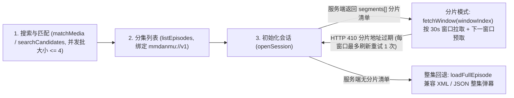

# 跨端分片弹幕协议、缓存与渲染规范（`danmu-segment-protocol.md`）

> **适用里程碑**：M3a（S31 Android 分片弹幕引擎与 `DanmakuView` 升级、S32 Flutter 弹幕核心与 `DanmuLayer`，不改播放器主控文件）、M3b（变基后挂载至 `PlaybackControls.java`、`player_screen.dart`、`SettingsScreen.java`）、R3 跨端一致性与压测评审。

---

## 1. 合规边界与服务地址约定

1. **零内置服务与零硬编码密钥**：
   - 弹幕服务地址默认值为**空字符串 `""`**（`danmu_server_urls = ""`），仅在用户主动填写合法获取的弹弹play（Dandanplay）Open API v2 兼容服务地址或导入本地 XML/JSON 弹幕文件后发起请求。
   - 严禁在代码、测试或配置中内置任何第三方真实服务器地址、`AppId` 或 `AppSecret`。仓库内所有文档示例与单元测试模拟地址一律使用保留测试域名（如 `https://danmu.example`、`https://node-a.danmu.test`、`http://127.0.0.1:<port>`），确保 `scripts/check_public_content.py` 100% 通过。
2. **可选公开 API 签名与限流礼仪**：
   - 当用户同时选填自定义 `appId` 与 `appSecret` 时，按公开 Open API v2 规范附加请求头：`X-AppId`、`X-Timestamp`（Unix 秒级时间戳）、`X-Signature = Base64(SHA256(appId + timestamp + urlPath + appSecret))`；未填写凭据时直接发送标准无签名请求以兼容自建免鉴权服务。
   - 单域名限流：同一服务源相邻两次请求最小间隔 `>= 200ms`；收到 `HTTP 429` 时读取 `Retry-After`（缺省退避 `2000ms`），绝不死循环轰炸服务端。
3. **HarmonyOS NEXT 隔离约束**：
   - Flutter 新增弹幕模块不得引入任何原生插件（仅使用纯 Dart、`http`、`shared_preferences`、`CustomPainter`、`Ticker`）；在 `OhosRuntime.isOhos` 为真时默认关闭弹幕层与网络拉取，且不触碰 `flutter/ohos/` 与 `flutter/lib/ui/tv/**`。

---

## 2. 净室三阶段协议与来源绑定编码

### 2.1 来源绑定分集标识（`SourceBoundEpisodeId`）

为支持用户同时配置多个兼容弹幕服务源（最多 `8` 个换行分隔地址）并在后续分集列表、分片拉取与 `410` 刷新时精准路由回原服务源，采用 Marco 标准自定义 URI 格式编码：

```text
mmdanmu://v1?src=<base64url_no_pad(normalizedOrigin)>&ep=<percent_encoded(rawEpisodeId)>
```

- `normalizedOrigin`：去除末尾 `/` 的标准 `http(s)://<host>[:port][/<basePath>]`；解码后必须经协议校验（仅允许 `http` / `https` 且必须在用户当前已配置的 `danmu_server_urls` 白名单内，防止外部注入任意 SSRF 地址）。
- `rawEpisodeId`：远端服务返回的原始剧集/弹幕库标识（数字字符串或复合串）。

### 2.2 请求流程与整集 / 分片双模式加载



1. **阶段 1 — 匹配与搜索（多源有界并发）**：
   - 自动匹配优先调用 `POST /api/v2/match`（传入清洗后的文件名/剧集名、文件时长秒数；不强制读取全文件哈希以避免网盘流额外流量），未命中时回退 `GET /api/v2/search/episodes?anime=<title>&episode=<epNo>`。
   - 多源调度器单批最大并发数 `maxConcurrency = 4`（范围 `1..5`），单源连接超时 `5000ms`、读取超时 `8000ms`。任一源超时或报错仅记入诊断日志，不阻断其余可用源返回候选结果。
2. **阶段 2 — 获取剧集列表**：
   - 调用 `GET /api/v2/bangumi/{animeId}` 获取分集清单，将每集 `episodeId` 封装为 `mmdanmu://v1?src=...&ep=...`。
3. **阶段 3 — 会话初始化与 30 秒分片窗口对齐**：
   - `openSession(boundEpisodeId)`：先探测服务端是否提供分片清单（如扩展字段 `segments: [{ startMs, endMs, url }]` 或支持按秒切片参数 `from` / `to`）；若服务端仅支持标准 `GET /api/v2/comment/{ep}?withRelated=true&chConvert=0`，则平滑进入 `FULL_EPISODE` 整集模式（同时完整保留 Android 现有 `DanmakuView.load(url, headers, listener)` 与 `loadText(text, listener)` 接口兼容）。
   - **30 秒窗口对齐公式**：
     - 有效媒体时钟：`effectiveMs = max(0, playerPositionMs + userTimeOffsetMs)`
     - 窗口索引：`windowIndex = floor(effectiveMs / 30000)`
     - 窗口左闭右开区间：`[windowIndex * 30000, (windowIndex + 1) * 30000)`（单位 `ms`）
     - 分片清单区间重叠判定：采用严格半开交集 `segment.startMs < windowEndMs && segment.endMs > windowStartMs`，天然避免分片右端点落在 `30000ms` 整倍数时的重复拉取或漏片边界错误。
   - **标准弹幕字段归一化**：
     - 兼容 JSON `{ count, comments: [{ cid, p: "timeSec,mode,color[,uid]", m: "text" }] }`、简化数组 `[timeSec, mode, color, text]` 及 Bilibili 风格 `<d p="timeSec,mode,fontSize,color,...">text</d>` XML（保留 `DanmakuData.java` 禁外部实体 `<!DOCTYPE` / `<!ENTITY` 安全校验）。
     - 统一转换为 `DanmuItem(String id, long timeMs, int mode, int rgbColor, String text)`，按 `(timeMs ASC, id ASC)` 稳定排序并按 `id` 去重（防止相邻分片边界重复弹幕二次入轨）。

---

## 3. 缓存预算、`HTTP 410` 单次重试与 Seek 风暴防抖

| 机制 | 参数 / 上限 | 强制行为规范 |
| :--- | :--- | :--- |
| **窗口预取** | 播放至当前窗口 `60%`（`+18000ms`） | 仅在播放中（`playing && !seeking`）后台预取 `windowIndex + 1`，同一时刻最多 1 个预取请求 |
| **LRU 窗口缓存** | 最多缓存 **`24` 个窗口**（覆盖 12 分钟） | 超出 `24` 个窗口时按 LRU 淘汰最久未访问窗口（固定保护 `currentWindow` 与 `currentWindow + 1`） |
| **内存与条数上限** | 单窗口 `<= 1,500` 条；整集 `<= 20,000` 条 / `8 MB`；活跃缓存总计 `<= 18,000` 条；单条文本 `<= 180` 字符 | 超限时按时间均匀抽稀或截断，严禁无界增长导致低配盒子 OOM |
| **`HTTP 410` 刷新** | **每窗口严格最多重试 `1` 次** | 会话内维护 `Set<Integer> retried410Windows` 与单飞锁 `singleFlightRefresh`：某窗口首次返回 `HTTP 410` 时加入集合、重新调用 `openSession` 刷新分片目录并重试该窗口 1 次；若重试仍返回 `410` 或该窗口已在集合内，**立即停止重试并标记该窗口为空/失败**，彻底杜绝死循环 |
| **Seek 风暴防抖与取消** | 防抖窗口 **`180ms`**（`150ms..200ms`） | 用户连续拖动进度条或按住快进键期间：每次位置跳变立即取消前一次 `180ms` 定时器并中断尚未完成的非当前窗口 HTTP 请求（Java `HttpURLConnection.disconnect` / Ticket 递增丢弃；Dart 取消令牌）；仅当进度稳定满 `180ms` 后才发起目标 `windowIndex` 请求 |

---

## 4. 轨道无碰撞排版、ReDoS 安全屏蔽词与层级避让

### 4.1 固定行数 + 追及碰撞检测（修复 `DanmakuView.java:325` `i % lanes` 重叠问题）

1. **轨道划分**：在可视区高度 `H` 与显示区域比例 `area`（`0.25 / 0.50 / 0.75 / 1.00`）内计算可用行数：
   `maxRows = clamp(minRows, platformRowCap, floor((usableHeight * area) / (fontSizePx * 1.42)))`。
2. **滚动弹幕（`mode == 1`）入轨判定**：
   - 每条轨道 `r`（`0 .. maxRows - 1`）仅维护上一条已入轨弹幕的 `trailClearTimeMs[r]`（右边缘完全进入屏幕左移 `24px` 安全间距的时刻）与 `leadExitTimeMs[r]`（左边缘完全移出屏幕左边界的时刻）。
   - 新弹幕 `c`（宽度 `W_c`、展示时长 `D_c`、速度 `v_c = (W_view + W_c) / D_c`）在时刻 `t0` 尝试从第 `0` 行起自上而下寻找首个满足以下两条件的轨道：
     - **出发不重叠**：`t0 >= trailClearTimeMs[r]`；
     - **途中不追尾**：若 `v_c > v_prev`，需满足 `t0 + (W_view / v_c) >= leadExitTimeMs[r] + 40ms`。
   - **满轨丢弃策略**：若全部轨道均不满足条件，直接丢弃该帧超载弹幕（不在同一行强行叠字）。
3. **顶部（`mode == 5`）与底部（`mode == 4`）固定弹幕**：
   - 独立维护固定轨道占用截止时间 `pinnedUntilMs[r] = t0 + 4000ms`；顶部自上而下分配，底部在避让区上方自下而上分配。
4. **渲染零分配要求**：
   - Android `DanmakuView`：复用 `Paint`、`strokePaint` 与轨道数组，缓存 `Comment.cachedWidth`，`onDraw` 内严禁 `new` 对象或字符串拼接。
   - Flutter `DanmuLayer`（`CustomPainter` + `Ticker`）：预排版并按 `(text, fontSize, scale)` 在有界池中复用 `TextPainter`，暂停时挂起推进、倍速时将弹幕运动速度乘以 `clamp(playSpeed, 0.5, 2.0)` 同步跟随。桌面 4K 窗口同屏 `300` 条弹幕时 UI 线程单帧耗时目标 `< 8ms`。

### 4.2 屏蔽词过滤与正则灾难性回溯（ReDoS）防护

- 支持最多 **`100` 条**用户屏蔽规则：默认按大小写不敏感纯文本子串匹配（`O(N)`）；以 `re:` 开头的规则按正则表达式解析。
- **强制 ReDoS 安全守卫（Java 与 Dart 双端一致校验）**：
  1. 去掉 `re:` 后正则长度不得超过 **`120` 个字符**；
  2. 编译前执行静态语法扫描，**拒绝**任何包含以下高危结构的表达式：
     - 嵌套量词（分组内部已含 `*` / `+` / `{m,n}`，且分组闭合括号后紧跟 `*` / `+` / `?` / `{`，例如 `(a+)+`、`(.*x){3}`）；
     - 反向引用（`\1`..`\9`）、后行断言（`(?<=`、`(?<!`）及内联模式修饰符；
  3. 不合规正则在设置界面直接提示「规则包含不支持或高风险的通配结构」并拒绝入库，运行时单条弹幕（`<= 180` 字符）过滤耗时恒定在微秒级。

### 4.3 Z 轴顺序修正与底部字幕安全避让（`PlaybackControls.java:143-150`）

- **现状缺陷**：`PlaybackControls` 构造时先后执行 `addView(danmaku, 1)` 与 `addView(subtitle, 1)`，导致 `DanmakuView` 被挤到索引 `2`，盖在 `SubtitleOverlayView`（索引 `1`）上方遮挡字幕。
- **M3b 规范要求**：修正 `playbackLayer` 子视图从底到顶的严格顺序为：
  `[0] 视频渲染表面` -> **`[1] 弹幕层（DanmakuView / DanmuLayer）`** -> **`[2] 字幕层（SubtitleOverlayView）`** -> `[3] 常驻细进度条 / 主控栏 / HUD 浮层`。
- **底部安全边距**：底部固定弹幕（`mode == 4`）及 `area >= 0.75` 时的最底行轨道，必须预留底部安全净空 `bottomSafeInset = max(44dp, subtitleBottomClearanceDp)`，避免与字幕主行或 `SlimProgressBar` 视觉打架。

### 4.4 设置项默认值、电视端自适应降级与桌面快捷键

| 设置项 | 移动 / 桌面默认值 | Android 电视默认值 | 取值范围 |
| :--- | :--- | :--- | :--- |
| 默认开启弹幕 | `false`（记住上次开关） | `false` | `true` / `false` |
| 不透明度（`opacity`） | `0.85` | `0.85` | `0.20 .. 1.00`（步进 `0.05`） |
| 显示区域（`displayArea`） | `0.50`（半屏） | `0.50`（半屏） | `0.25 / 0.50 / 0.75 / 1.00` |
| 字号（`fontSize`） | `20` | `24` | 移动/桌面 `14..32`；电视 `18..36` |
| 滚动速度档位（`speedMultiplier`） | `1.0x`（基准 `7600ms`） | `1.0x`（基准 `8200ms`） | `0.75x / 1.0x / 1.25x / 1.5x` |
| 时间轴偏移（`timeOffsetMs`） | `0ms` | `0ms` | `-30000ms .. +30000ms`（步进 `500ms`） |
| 类型开关（滚动 / 顶部 / 底部） | 全开 | 全开 | 独立布尔值 |
| 最大轨道行数 / 同屏上限 | `14` 行 / 移动 `120`、桌面 `300` 条 | **`6` 行 / `48` 条** | 电视端自动动态降级 `2..8` 行 |

- **电视端帧耗时自适应降级（保障 Android 9 ARM32 `>= 50fps`）**：
  - `DanmakuView` 每渲染 `30` 帧统计一次帧间隔 P90：若连续 `2` 个统计周期 `P90 > 20.0ms`（低于 `50fps`），自动将当前有效行数上限 `effectiveMaxRows` 下调 `2` 行（最低保底 **`2` 行**，同屏上限同步收紧至 `20` 条）；仅当连续 `180` 帧（约 `3s`）`P90 < 15.5ms` 时才逐级 `+1` 恢复至用户设定上限。
- **桌面端弹幕快捷键**：绑定单键 **`D`**（`LogicalKeyboardKey.keyD`，已核实与 `player_screen.dart` 现有 `M / N / P / F / F1 / F11 / Space / Enter / Esc / [ / ] / 方向键` 零冲突；输入框获焦时不触发）。

---

## 5. Java 与 Dart 共享接口签名

### 5.1 Android Java 接口（`com.pilipala.marcomovie`）

```java
public interface DanmuProvider {
    final class MatchQuery {
        public final String title;
        public final String episodeTitle;
        public final int episodeIndex;
        public final long durationSec;
        public MatchQuery(String title, String episodeTitle, int episodeIndex, long durationSec) {
            this.title = title;
            this.episodeTitle = episodeTitle;
            this.episodeIndex = episodeIndex;
            this.durationSec = durationSec;
        }
    }

    final class Candidate {
        public final String sourceOrigin;
        public final String animeId;
        public final String animeTitle;
        public final String boundEpisodeId; // mmdanmu://v1?src=...&ep=...
        public final String episodeTitle;
        public final double confidence;
        public Candidate(String sourceOrigin, String animeId, String animeTitle,
                String boundEpisodeId, String episodeTitle, double confidence) {
            this.sourceOrigin = sourceOrigin;
            this.animeId = animeId;
            this.animeTitle = animeTitle;
            this.boundEpisodeId = boundEpisodeId;
            this.episodeTitle = episodeTitle;
            this.confidence = confidence;
        }
    }

    final class SegmentDescriptor {
        public final long startMs;
        public final long endMs;
        public final String segmentUrl;
        public SegmentDescriptor(long startMs, long endMs, String segmentUrl) {
            this.startMs = startMs;
            this.endMs = endMs;
            this.segmentUrl = segmentUrl;
        }
    }

    final class EpisodeSession {
        public final String boundEpisodeId;
        public final boolean segmented;
        public final List<SegmentDescriptor> segments; // empty when FULL_EPISODE
        public final List<DanmuItem> preloadComments;  // populated when FULL_EPISODE
        public EpisodeSession(String boundEpisodeId, boolean segmented,
                List<SegmentDescriptor> segments, List<DanmuItem> preloadComments) {
            this.boundEpisodeId = boundEpisodeId;
            this.segmented = segmented;
            this.segments = segments;
            this.preloadComments = preloadComments;
        }
    }

    final class DanmuItem {
        public final String id;
        public final long timeMs;
        public final int mode; // 1=scroll, 4=bottom, 5=top
        public final int rgbColor;
        public final String text;
        public DanmuItem(String id, long timeMs, int mode, int rgbColor, String text) {
            this.id = id;
            this.timeMs = timeMs;
            this.mode = mode;
            this.rgbColor = rgbColor;
            this.text = text;
        }
    }

    List<Candidate> matchOrSearch(MatchQuery query, CancellationToken token) throws IOException;
    List<Candidate> listEpisodes(String sourceOrigin, String animeId, CancellationToken token) throws IOException;
    EpisodeSession openSession(String boundEpisodeId, CancellationToken token) throws IOException;
    List<DanmuItem> fetchWindow(EpisodeSession session, int windowIndex, CancellationToken token) throws IOException;
}
```

`DanmuSegmentCache` 核心方法签名：
- `void bindSession(String boundEpisodeId)`
- `void onPlaybackTick(long positionMs, boolean playing)`（对齐 `30000ms` 窗口 + `60%` 阈值预取下一窗口）
- `void onSeekInitiated()` / `void onSeekSettled(long targetPositionMs)`（`180ms` 防抖 + 取消旧请求）
- `List<DanmuProvider.DanmuItem> visibleWindowSnapshot(long effectiveMs)`
- `void close()`

### 5.2 Flutter Dart 接口（`flutter/lib/core/danmu/provider.dart` & `segment_cache.dart`）

```dart
abstract class DanmuProvider {
  Future<List<DanmuCandidate>> matchOrSearch(
    DanmuMatchQuery query, {
    DanmuCancelToken? cancelToken,
  });

  Future<List<DanmuCandidate>> listEpisodes(
    String sourceOrigin,
    String animeId, {
    DanmuCancelToken? cancelToken,
  });

  Future<DanmuEpisodeSession> openSession(
    String boundEpisodeId, {
    DanmuCancelToken? cancelToken,
  });

  Future<List<DanmuItem>> fetchWindow(
    DanmuEpisodeSession session,
    int windowIndex, {
    DanmuCancelToken? cancelToken,
  });
}

class DanmuSegmentCache {
  static const int windowDurationMs = 30000;
  static const int maxCachedWindows = 24;
  static const int maxWindowItems = 1500;
  static const int maxTotalItems = 18000;
  static const int seekDebounceMs = 180;

  Future<void> bindSession(String boundEpisodeId);
  void onPlaybackTick(int positionMs, {required bool playing});
  void onSeekChanged(int targetPositionMs);
  List<DanmuItem> snapshotForPosition(int effectiveMs);
  void dispose();
}
```

---

## 6. 不在范围内（Out of Scope）

1. **发送弹幕 / 用户账号登录发评 / 互动点赞举报**：客户端只做只读弹幕拉取、本地文件加载与渲染。
2. **BAS / 高级矢量代码弹幕、特殊路径动画弹幕与自定义字体包下发**：统一以高性能单行描边文字渲染。
3. **Android Lite（API 14）、Apple TV（`tvos/`）与 HarmonyOS NEXT（`flutter/ohos/`、`flutter/lib/ui/tv/**`）弹幕接入**。
4. **内置任何默认公共弹幕服务器域名或抓取网页 HTML 解析第三方视频站弹幕**。
