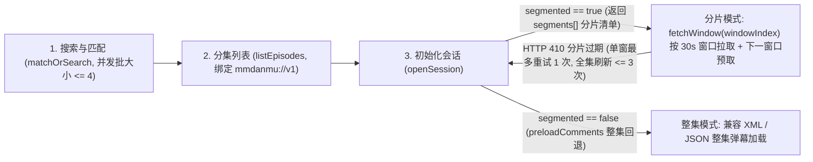

# 跨端分片弹幕协议、缓存与渲染规范（`danmu-segment-protocol.md`）

> **适用里程碑**：M3a（S31 Android 分片弹幕引擎与 `DanmakuView` 升级、S32 Flutter 弹幕核心与 `DanmuLayer`，不改播放器主控文件）、M3b（变基后挂载至 `PlaybackControls.java`、`player_screen.dart`、`SettingsScreen.java`）、R3 跨端一致性与压测评审。

---

## 1. 合规边界、平台兼容与 M3a/M3b 写入隔离

1. **零内置服务与零硬编码密钥**：
   - 弹幕服务地址默认值为**空字符串 `""`**（`danmu_server_urls = ""`），仅在用户主动填写合法获取的弹弹play（Dandanplay）Open API v2 兼容服务地址或导入本地 XML/JSON 弹幕文件后发起请求。
   - 严禁在代码、测试或配置中内置任何第三方真实服务器地址、`AppId` 或 `AppSecret`。仓库内所有文档示例与单元测试模拟地址一律使用保留测试域名（如 `https://danmu.example`、`https://node-a.danmu.test`、`http://127.0.0.1:<port>`），确保 `scripts/check_public_content.py` 100% 通过。
2. **可选公开 API 签名与限流礼仪**：
   - 当用户同时选填自定义 `appId` 与 `appSecret` 时，按公开 Open API v2 规范附加请求头：`X-AppId`、`X-Timestamp`（Unix 秒级时间戳）、`X-Signature = Base64(SHA256(appId + timestamp + urlPath + appSecret))`；未填写凭据时发送标准无签名请求。
   - 单域名限流：同一服务源相邻两次请求最小间隔 `>= 200ms`；收到 `HTTP 429` 时读取 `Retry-After`（缺省退避 `2000ms`）。
3. **M3a / M3b 写入边界与 Android API 23 / 纯 JVM 兼容约束（对齐 §4.1）**：
   - **偏好键隔离**：为避免与并行开发的 M2 冲突，M3a 与 M3b **均不得修改 `Prefs.java` 或 `storage_service.dart`**；弹幕偏好键统一在 `DanmuSettingsPanel.java`（直接读写 `SharedPreferences`）与 `flutter/lib/core/danmu/` 内部自包含定义。
   - **自包含 Base64url 编解码**：Android `minSdk = 23`（禁用 API 26+ 的 `java.util.Base64`）且 `run_checks.py` 为无 Android SDK 的纯 JVM 环境（避免直接耦合 `android.util.Base64`），Java 侧必须在 `DanmuProvider` / `DandanplayProvider` 内部附带约 25 行零依赖 RFC 4648 Base64url（无填充 `=`）与 SHA-256 编解码工具方法。
4. **HarmonyOS NEXT 隔离约束**：
   - Flutter 新增弹幕模块不得引入任何原生插件；在 `OhosRuntime.isOhos` 为真时默认关闭弹幕层与网络拉取，严禁触碰 `flutter/ohos/` 与 `flutter/lib/ui/tv/**`。

---

## 2. 净室三阶段协议与来源绑定编码

### 2.1 来源绑定分集标识（`SourceBoundEpisodeId`）

为支持用户同时配置多个兼容弹幕服务源（最多 `8` 个换行分隔地址）并在后续分集列表、分片拉取与 `410` 刷新时精准路由回原服务源，采用 Marco 标准自定义 URI 格式编码：

```text
mmdanmu://v1?src=<base64url_no_pad(normalizedOrigin)>&ep=<percent_encoded(rawEpisodeId)>
```

- `normalizedOrigin`：去除末尾 `/` 的标准 `http(s)://<host>[:port][/<basePath>]`；解码后必须经协议校验（仅允许 `http` / `https` 且必须在用户当前已配置的 `danmu_server_urls` 白名单内，防止外部注入任意 SSRF 地址）。
- `rawEpisodeId`：远端服务返回的原始剧集/弹幕库标识。

### 2.2 请求流程与整集 / 分片双模式加载



1. **阶段 1 — 匹配与搜索（`matchOrSearch`，多源有界并发）**：
   - 自动匹配优先调用 `POST /api/v2/match`（传入清洗后的文件名/剧集名、文件时长秒数），未命中时回退 `GET /api/v2/search/episodes?anime=<title>&episode=<epNo>`。
   - 多源调度器单批最大并发数 `maxConcurrency = 4`（范围 `1..5`），单源连接超时 `5000ms`、读取超时 `8000ms`。任一源失败隔离记入日志，不阻断其余可用源。
2. **阶段 2 — 获取剧集列表（`listEpisodes`）**：
   - 调用 `GET /api/v2/bangumi/{animeId}` 获取分集清单，将每集 `episodeId` 封装为 `mmdanmu://v1?src=...&ep=...`。
3. **阶段 3 — 会话初始化（`openSession`）与有符号时钟 / 30 秒分片窗口对齐**：
   - 若服务端提供分片清单（`segments: [{ startMs, endMs, segmentUrl }]` 或秒级切片参数），置 `segmented = true`；若仅支持标准 `GET /api/v2/comment/{ep}?withRelated=true&chConvert=0`，置 `segmented = false` 并在 `preloadComments` 返回整集列表（同时完整保留 Android 现有 `DanmakuView.load(url, headers, listener)` 与 `loadText(text, listener)` 兼容）。
   - **有符号渲染时钟 vs 非负分片索引公式（防止负向延迟冻结 `0.0s` 弹幕）**：
     - **有符号有效媒体时钟**：`effectiveMs = playerPositionMs + userTimeOffsetMs`（**严禁对渲染时钟做 `max(0, ...)` 截断**！当用户设置负偏移如 `-10000ms` 且 `playerPositionMs < 10000ms` 时，`effectiveMs < 0`，`visibleWindowSnapshot(effectiveMs)` 直接返回空列表 `[]`，使 `0.0s` 弹幕等到 `playerPositionMs == 10000ms` 才正常入场，绝不在片头前 10 秒冻结停留在屏幕上）。
     - **非负分片拉取索引**：`fetchWindowIndex = max(0, floor(effectiveMs / 30000))`（当 `effectiveMs < 0` 时固定拉取/预备第 `0` 号窗口 `[0, 30000)`，保证 `windowIndex` 永远 `>= 0`）。
     - **窗口左闭右开区间**：`[windowIndex * 30000, (windowIndex + 1) * 30000)`（单位 `ms`）；分片清单重叠判定采用严格半开交集 `segment.startMs < windowEndMs && segment.endMs > windowStartMs`。
   - **标准弹幕字段归一化**：
     - 兼容 JSON `{ count, comments: [{ cid, p: "timeSec,mode,color[,uid]", m: "text" }] }`、简化数组 `[timeSec, mode, color, text]` 及 XML `<d p="...">`（保留 `DanmakuData.java:55-56` 禁外部实体 `<!DOCTYPE` / `<!ENTITY` 校验），统一转换为 `DanmuItem(id, timeMs, mode, rgbColor, text)`，按 `(timeMs ASC, id ASC)` 排序并按 `id` 去重。

---

## 3. 跨窗口无缝拼接、`HTTP 410` 纪元单次重试与 Seek 风暴防抖

| 机制 | 参数 / 上限 | 强制行为规范 |
| :--- | :--- | :--- |
| **窗口预取** | `effectiveMs >= fetchWindowIndex * 30000 + 18000` | 仅在播放中（`playing && !seeking`）且有效时钟越过当前窗口 `60%`（`+18000ms`）时后台预取 `fetchWindowIndex + 1`，同一时刻最多 1 个预取请求 |
| **三窗口钉住与跨界无缝读取** | 钉住 `{max(0, w - 1), w, w + 1}`；LRU 最多 **`24` 个窗口** | 因慢速滚动弹幕最长存活约 `11000ms`，当 `effectiveMs` 跨越 `30000ms` 整倍边界进入窗口 `w` 时，`[w*30000 - 12000, w*30000)` 内的在途弹幕位于 `w - 1`！因此 LRU 必须同时钉住 `w - 1`、`w`、`w + 1`，且 `visibleWindowSnapshot(effectiveMs)` 必须合并 `w - 1`（若 `>= 0` 且已缓存）与 `w` 中命中 `[effectiveMs - 12000, effectiveMs]` 的弹幕并按 `id` 去重，杜绝 30 秒交界处弹幕半空瞬移消失 |
| **内存与条数上限联动** | 单窗口 `<= 1,500` 条；整集 `<= 20,000` 条 / `8 MB`；活跃缓存总计 `<= 18,000` 条；单条 `<= 180` 字符 | 当多窗口累计条数先于 `24` 窗口触及 `18,000` 条上限时，立即按 LRU 提前淘汰最久未访问的**非钉住窗口**（绝不淘汰 `{w - 1, w, w + 1}`） |
| **`HTTP 410` 纪元刷新** | **每窗口严格最多重试 `1` 次；单集会话总刷新 `<= 3` 次** | 维护 `int sessionEpoch`、`Set<Integer> retried410Windows` 与单飞锁 `singleFlightRefresh`：若窗口 `w` 与预取 `w + 1` 在同一旧纪元 `epoch = k` 并发遇到 `410`，首个进入者调用 `openSession` 升级至 `epoch = k + 1`（累计会话刷新次数 `+1`），后者直接复用 `epoch = k + 1` 的新目录重试而不再重复请求 `openSession`；已在 `retried410Windows` 内的窗口或会话刷新已达 `3` 次时**立即停止重试并标记该窗口为空**，彻底封死死循环与慢速放大请求 |
| **Seek 风暴防抖与取消** | 防抖窗口 **`180ms`**（`150ms..200ms`） | 连续拖动或快进期间：每次位置跳变立即取消前一次 `180ms` 定时器并中断在途旧窗口 HTTP 请求；仅当进度稳定满 `180ms` 后才按最新 `effectiveMs` 请求目标窗口 |

---

## 4. 轨道无碰撞排版、ReDoS 零回溯屏蔽词与层级避让

### 4.1 固定行数 + 尾缘追及碰撞检测（修复 `DanmakuView.java:325` `i % lanes` 与半途重叠问题）

1. **轨道划分与默认边界**：
   - 保底最小行数 `minRows = 2`；字号单位在 Android 为 `sp`（随密度换算 `fontSizePx`）、在 Flutter 为 `lp`（乘以 `textScaler.clamp(0.85, 1.35)`）。
   - 可用行数：`maxRows = clamp(2, platformRowCap, floor((usableHeight * area) / (fontSizePx * 1.42)))`。
2. **滚动弹幕（`mode == 1`）严格尾缘无碰撞运动学公式**：
   - 设轨道 `r`（`0 .. maxRows - 1`）上一条已入轨弹幕在时刻 `t_prev` 从右边界 `x = W_view` 出发，文本像素宽度为 `W_prev`，总滚过时长为 `D_prev`，匀速速度为 `v_prev = (W_view + W_prev) / D_prev`：
     - **右边界净空时刻**（前一条弹幕尾端完全进入屏幕并留出 `24px` 间距）：
       `entryClearTimeMs[r] = t_prev + (W_prev + 24.0) / v_prev`
     - **左边界尾缘退出时刻**（前一条弹幕**右尾缘**加上 `24px` 间距完全移出左边界 `x = 0` 的时刻；注意 `t_prev + D_prev` 时其右尾缘恰好到达 `x = 0`）：
       `tailExitTimeMs[r] = t_prev + D_prev + (24.0 / v_prev)`
   - 新弹幕 `c`（生成时刻 `t0`、宽度 `W_c`、时长 `D_c`、速度 `v_c = (W_view + W_c) / D_c`）自上而下寻找首个同时满足以下两条件的轨道 `r`：
     1. **出发不重叠（`x = W_view` 处间距 `>= 24px`）**：`t0 >= entryClearTimeMs[r]`；
     2. **全程不追尾（`x = 0` 处左前缘不早于前车右尾缘退出）**：若 `v_c > v_prev`，必须满足 `t0 + (W_view / v_c) >= tailExitTimeMs[r]`。
   - *线性运动学完备性保证*：因两弹幕均为匀速直线运动，只要在右端点 `x = W_view` 与左端点 `x = 0` 两处间距均 `>= 24px`，在屏幕任意中间位置 `x in [0, W_view]` 间距必恒 `>= 24px`，彻底消除长弹幕半途追上短弹幕造成的文字叠印。
   - **满轨丢弃策略**：若全部轨道均不满足条件，直接丢弃该条超载弹幕，绝不同行强叠。
3. **顶部（`mode == 5`）与底部（`mode == 4`）固定弹幕**：
   - 独立维护占用截止时刻 `pinnedUntilMs[r] = t0 + 4000ms`；顶部自上而下分配，底部在安全避让区上方自下而上分配。
4. **渲染零分配要求**：
   - Android `DanmakuView`：复用 `Paint`、`strokePaint` 与轨道数组，缓存 `Comment.cachedWidth`，`onDraw` 内严禁分配对象。
   - Flutter `DanmuLayer`（`CustomPainter` + `Ticker`）：有界池复用预排版 `TextPainter`，暂停挂起、倍速同步乘以 `clamp(playSpeed, 0.5, 2.0)`；桌面 4K 窗口同屏 `300` 条弹幕时 UI 线程单帧耗时 `< 8ms`。

### 4.2 屏蔽词过滤与正则灾难性回溯（ReDoS）严密防护

- 支持最多 **`100` 条**用户屏蔽规则：默认按大小写不敏感纯文本子串匹配（`O(N)`）；以 `re:` 开头的规则按正则表达式解析。
- **强制静态 ReDoS 验证器（封堵嵌套量词、可选量词组与重叠交替回溯）**：
  1. 去掉 `re:` 前缀后，表达式长度必须 **`<= 120` 个字符**，且通配片段 `.*` / `.+` 出现总次数 **`<= 3` 次**；
  2. 编译前执行单遍转义感知扫描，**一律拒绝**包含以下任一构造的表达式：
     - **任何闭合圆括号 `)`（非转义 `\)`）后紧跟量词（`*`、`+`、`?`、`{`）**——该规则一次性彻底阻断 `(a+)+`、`(a?)+`、`(.*a){20}` 以及重叠分支回溯 `(a|aa)+$`、`([a-z]|a)+$`，同时完全放行顶层交替（如 `re:剧透|打卡`）、无量词分组（如 `re:第(一|二)章`）与字符类量词（如 `re:[0-9]{4,}`）；
     - 反向引用（`\1`..`\9`）、后行断言（`(?<=`、`(?<!`）及内联修饰符（`(?i` 等）；
  3. 未通过静态检查的规则在设置页直接提示不予保存，确保任意单条弹幕（`<= 180` 字符）匹配恒在微秒级完成。

### 4.3 Z 轴顺序修正与底部字幕安全避让（`PlaybackControls.java:143-150`）

- **M3b 规范要求**：修正 `playbackLayer` 子视图从底到顶严格顺序为：
  `[0] 视频渲染表面` -> **`[1] 弹幕层（DanmakuView / DanmuLayer）`** -> **`[2] 字幕层（SubtitleOverlayView）`** -> `[3] 常驻细进度条 / 主控栏 / HUD 浮层`。
- **底部安全边距**：底部固定弹幕（`mode == 4`）及 `area >= 0.75` 时的最底行轨道，必须预留底部安全净空 `bottomSafeInset = max(44dp, subtitleBottomClearanceDp)`。

### 4.4 设置项默认值、电视端自适应降级与桌面快捷键

| 设置项 | 移动 / 桌面默认值 | Android 电视默认值 | 取值范围 |
| :--- | :--- | :--- | :--- |
| 默认开启弹幕 | `false`（记住上次开关） | `false` | `true` / `false` |
| 不透明度（`opacity`） | `0.85` | `0.85` | `0.20 .. 1.00`（步进 `0.05`） |
| 显示区域（`displayArea`） | `0.50`（半屏） | `0.50`（半屏） | `0.25 / 0.50 / 0.75 / 1.00` |
| 字号（`fontSize`） | `20lp` / `20sp` | `24sp` | 移动/桌面 `14..32`；电视 `18..36` |
| 滚动速度档位（`speedMultiplier`） | `1.0x`（基准 `7600ms`） | `1.0x`（基准 `8200ms`） | `0.75x / 1.0x / 1.25x / 1.5x` |
| 时间轴偏移（`timeOffsetMs`） | `0ms` | `0ms` | `-30000ms .. +30000ms`（步进 `500ms`） |
| 类型开关（滚动 / 顶部 / 底部） | 全开 | 全开 | 独立布尔值 |
| 最大轨道行数 / 同屏上限 | `14` 行 / 移动 `120`、桌面 `300` 条 | **`6` 行 / `48` 条** | 电视端自动动态降级 `2..8` 行 |

- **电视端帧耗时自适应降级（保障 Android 9 ARM32 `>= 50fps`）**：每 `30` 帧统计一次帧间隔 P90，连续 `2` 周期 `P90 > 20.0ms` 时将 `effectiveMaxRows` 下调 `2` 行（保底 `minRows = 2` 行、同屏 `20` 条）；连续 `180` 帧 `P90 < 15.5ms` 时逐级 `+1` 恢复。
- **桌面端弹幕快捷键**：单键 **`D`**（`LogicalKeyboardKey.keyD`，输入框获焦时不触发）。

---

## 5. Java 与 Dart 共享接口签名

### 5.1 Android Java 接口（`com.pilipala.marcomovie`）

```java
public interface DanmuProvider {
    final class MatchQuery {
        public final String title;
        public final String episodeTitle;
        public final int episodeIndex;
        public final long durationSec;
        public MatchQuery(String title, String episodeTitle, int episodeIndex, long durationSec) {
            this.title = title;
            this.episodeTitle = episodeTitle;
            this.episodeIndex = episodeIndex;
            this.durationSec = durationSec;
        }
    }

    final class Candidate {
        public final String sourceOrigin;
        public final String animeId;
        public final String animeTitle;
        public final String boundEpisodeId; // mmdanmu://v1?src=...&ep=...
        public final String episodeTitle;
        public final double confidence;
        public Candidate(String sourceOrigin, String animeId, String animeTitle,
                String boundEpisodeId, String episodeTitle, double confidence) {
            this.sourceOrigin = sourceOrigin;
            this.animeId = animeId;
            this.animeTitle = animeTitle;
            this.boundEpisodeId = boundEpisodeId;
            this.episodeTitle = episodeTitle;
            this.confidence = confidence;
        }
    }

    final class SegmentDescriptor {
        public final long startMs;
        public final long endMs;
        public final String segmentUrl;
        public SegmentDescriptor(long startMs, long endMs, String segmentUrl) {
            this.startMs = startMs;
            this.endMs = endMs;
            this.segmentUrl = segmentUrl;
        }
    }

    final class EpisodeSession {
        public final String boundEpisodeId;
        public final boolean segmented;
        public final List<SegmentDescriptor> segments; // empty when FULL_EPISODE
        public final List<DanmuItem> preloadComments;  // populated when FULL_EPISODE
        public EpisodeSession(String boundEpisodeId, boolean segmented,
                List<SegmentDescriptor> segments, List<DanmuItem> preloadComments) {
            this.boundEpisodeId = boundEpisodeId;
            this.segmented = segmented;
            this.segments = segments;
            this.preloadComments = preloadComments;
        }
    }

    final class DanmuItem {
        public final String id;
        public final long timeMs;
        public final int mode; // 1=scroll, 4=bottom, 5=top
        public final int rgbColor;
        public final String text;
        public DanmuItem(String id, long timeMs, int mode, int rgbColor, String text) {
            this.id = id;
            this.timeMs = timeMs;
            this.mode = mode;
            this.rgbColor = rgbColor;
            this.text = text;
        }
    }

    List<Candidate> matchOrSearch(MatchQuery query, CancellationToken token) throws IOException;
    List<Candidate> listEpisodes(String sourceOrigin, String animeId, CancellationToken token) throws IOException;
    EpisodeSession openSession(String boundEpisodeId, CancellationToken token) throws IOException;
    List<DanmuItem> fetchWindow(EpisodeSession session, int windowIndex, CancellationToken token) throws IOException;
}
```

`DanmuSegmentCache` 核心方法签名（内部统一通过 `effectiveMs = rawPositionMs + timeOffsetMs` 对齐窗口与快照）：
- `void bindSession(String boundEpisodeId)`
- `void setTimeOffsetMs(long offsetMs)`
- `void onPlaybackTick(long rawPositionMs, boolean playing)`（计算有符号 `effectiveMs` -> `fetchWindowIndex = max(0, floor(effectiveMs / 30000))` + `60%` 预取 `fetchWindowIndex + 1`）
- `void onSeekInitiated()` / `void onSeekSettled(long targetRawPositionMs)`（`180ms` 防抖 + 取消旧请求）
- `List<DanmuProvider.DanmuItem> visibleWindowSnapshot(long rawPositionMs)`（当 `effectiveMs < 0` 返回 `[]`；否则合并去重 `w - 1` 与 `w` 的活跃弹幕）
- `void close()`

### 5.2 Flutter Dart 接口（`flutter/lib/core/danmu/provider.dart` & `segment_cache.dart`）

```dart
abstract class DanmuProvider {
  Future<List<DanmuCandidate>> matchOrSearch(
    DanmuMatchQuery query, {
    DanmuCancelToken? cancelToken,
  });

  Future<List<DanmuCandidate>> listEpisodes(
    String sourceOrigin,
    String animeId, {
    DanmuCancelToken? cancelToken,
  });

  Future<DanmuEpisodeSession> openSession(
    String boundEpisodeId, {
    DanmuCancelToken? cancelToken,
  });

  Future<List<DanmuItem>> fetchWindow(
    DanmuEpisodeSession session,
    int windowIndex, {
    DanmuCancelToken? cancelToken,
  });
}

class DanmuSegmentCache {
  static const int windowDurationMs = 30000;
  static const int maxCommentLifetimeMs = 12000;
  static const int maxCachedWindows = 24;
  static const int maxWindowItems = 1500;
  static const int maxTotalItems = 18000;
  static const int maxSession410Refreshes = 3;
  static const int seekDebounceMs = 180;

  Future<void> bindSession(String boundEpisodeId);
  void setTimeOffsetMs(int offsetMs);
  void onPlaybackTick(int rawPositionMs, {required bool playing});
  void onSeekChanged(int targetRawPositionMs);
  List<DanmuItem> snapshotForPosition(int rawPositionMs);
  void dispose();
}
```

---

## 6. 不在范围内（Out of Scope）

1. **发送弹幕 / 用户账号登录发评 / 互动点赞举报**：客户端只做只读弹幕拉取、本地文件加载与渲染。
2. **BAS / 高级矢量代码弹幕、特殊路径动画弹幕与自定义字体包下发**。
3. **Android Lite（API 14）、Apple TV（`tvos/`）与 HarmonyOS NEXT（`flutter/ohos/`、`flutter/lib/ui/tv/**`）弹幕接入**。
4. **内置任何默认公共弹幕服务器域名或抓取网页 HTML 解析第三方视频站弹幕**。
