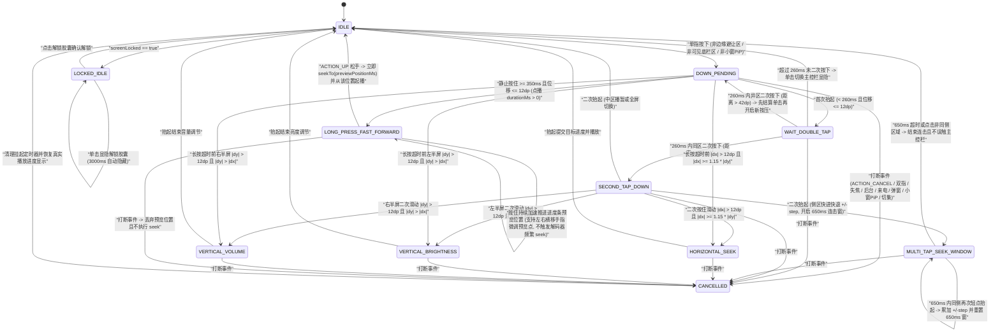
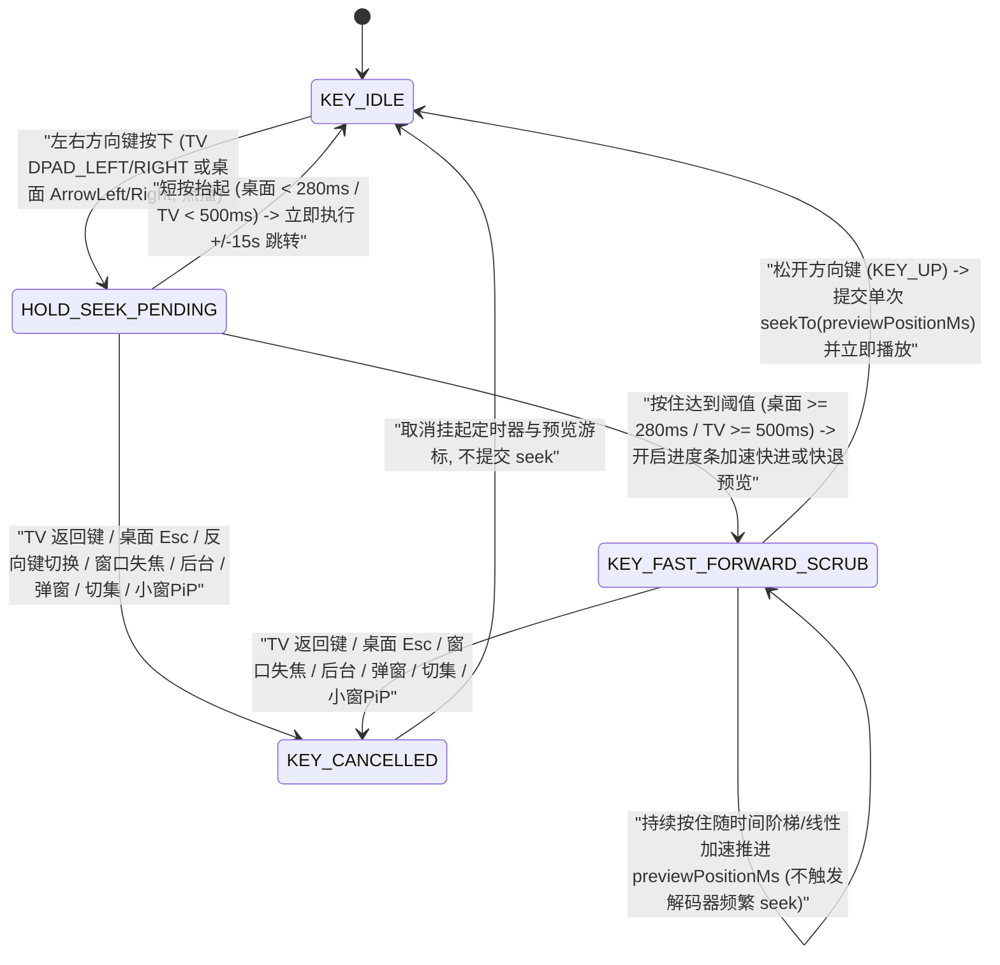

# 跨端播放页 HUD 与交互状态机规范（`player-hud-spec.md`）

> **适用里程碑**：M2（S21 Android 手机/平板、S22 Android 电视、S23 Flutter 桌面与 iOS/iPadOS）、R2 跨端评审。  
> **动效与样式引用**：所有动画时长、缓动曲线、弹簧参数及无障碍降级均引用同目录 `motion-tokens.json`；规格解析统一调用 M1 引擎与 `badge-rules.json`。

---

## 1. 设计目标、平台分级与 §4.1 写入边界对齐（已锁定）

### 1.1 纯逻辑状态机与视图解耦
将触控、遥控器方向键、桌面键鼠的输入判定收敛为无 UI 依赖的状态机（Android `PlayerGestureStateMachine.java`、Flutter `flutter/lib/ui/player/gesture_state_machine.dart`），在纯 JVM 与 `flutter test` 下可 100% 离线确定性单测；`TouchPlayerGesture.java`、`PlaybackControls.java`、`PlayerChrome.java` 与 `player_screen.dart` 仅保留最小事件转发与视图挂载。

### 1.2 平台性能与 HarmonyOS 隔离守卫
- **Android 电视（ARM32 Android 9 底线）**：HUD 背景严禁使用 `RenderEffect`、`BlurMaskFilter`、实时截图采样或片元着色器，统一采用高对比半透明纯色（`#D916161A` / 减少透明度时 `#F516161A`），确保 HUD 显隐与进度刷新稳定 `>= 50fps` 且零每帧对象分配。
- **Flutter 桌面与 iOS/iPadOS**：沿用基线 `apple_theme.dart` 样式层；毛玻璃组件仅在 HUD 可见期间挂载渲染，隐藏态彻底跳过着色器与模糊管线。
- **HarmonyOS NEXT 隔离约束**：所有新增 Flutter HUD 组件与手势扩展必须在入口处通过 `!OhosRuntime.isOhos` 门控默认关闭，对 `OhosPlatformPlayer` 缺失的 `videoParams` / `audioParams` 做空安全兜底，严禁修改 `flutter/ohos/` 与 `flutter/lib/ui/tv/**`。

### 1.3 下游里程碑 §4.1 写入边界锁定表
1. **Android 播放器核心严格只读**：`MoviePlayer.java`、`SystemPlayer.java`、`PlaybackController.java`、`SeekGesture.java` 与 `TvDetailHost.java` 全部保持**零修改**：
   - Android 起播规格提示直接消费现有的 `a.player.mediaBadges()` 纯文本列表与视频宽高，交由 M1 `MediaBadges` 做双通道融合；
   - Android TV 长按左右方向键完整沿用 `PlaybackController.dispatchPlaybackKey`（`:2067-2083`）-> `SeekGesture`（`:62-101`）加速快进/快退预览管线，S22 仅通过 `PlaybackControls.java`、`PlayerChrome.java` 与 `hud/*.java` 升级预览浮层与 3 秒跳过倒计时，与 `InteractionProbe.java` 100% 兼容且与 `:2026` `TvMarkerHost` 上键零冲突。
2. **M1 Lite 详情页最小接线（`LiteActivity.java`）**：S12 除新建 `LiteBadges.java` 外，仅在 `LiteActivity.java` 详情页元数据行（`:3977`）与线路胶囊（`:4114`）做纯文本拼接挂载。
3. **本机偏好存储隔离（不入跨端备份表）**：M2/M5 新增 Android 偏好键置于 `Prefs.KEYS` 之外（不纳入 `marco-movie-backup`）；M2 Flutter HUD 偏好在 `flutter/lib/ui/player/` 内直接读写 `SharedPreferences` 并在 `player_screen.dart` 播放设置面板暴露开关（不改 `storage_service.dart` 与 `ios_settings.dart`）；M3 弹幕偏好在 `DanmuSettingsPanel.java` 与 `flutter/lib/core/danmu/` 内部自包含管理。
4. **M5 首次播放提示槽位预留**：M2 在 `PlayerChrome` 与 `player_screen.dart` 预留可选的轻量浮层构建槽位（默认空），供 Wave 3 · M5（S52 / S53）注入 `FirstPlayGestureHint` 而不修改播放器内部代码。

---

## 2. 输入与手势状态机（Mermaid `stateDiagram-v2`）

### 2.1 触控端手势状态机（Android 手机/平板 & iOS/iPadOS）

### 2.2 电视遥控器与桌面键盘快进/快退预览消歧状态机

---

## 3. 手势、遥控器与键鼠详细规则及默认参数

### 3.1 触控阈值、长按加速快进与防误触规则

| 参数 / 持久化键名 | 默认值 | 说明 |
| :--- | :--- | :--- |
| `touchSlop` | `12dp` / `12lp` | 区分静止长按/点击与滑动手势的最小位移阈值 |
| `edgeBackGuardHorizontal` | `max(24dp, systemGestureInsetLeft/Right)`（iOS `24lp`） | 触点落入左右系统侧滑区时状态机直接忽略，完全让渡给系统返回手势（配合 iOS `MobilePlayerChrome.setImmersive`） |
| `systemInsetGuardVertical` | 顶部/底部各 `28dp` / `28lp` | 避让系统栏手势；主控栏展开时，落在顶栏或底部 Dock 内（`startedInsideDock`）不触发播放面手势 |
| `doubleTapTimeoutMs` / `Slop` | `260ms` / `42dp` | 必须在二次**抬起（`UP`）且位移 `<= 12dp`** 时触发双击，防止「单击紧接拖动」误判 |
| `player_double_tap_center` | 移动/平板 `"play_pause"`；桌面 `"fullscreen"` | 跨端统一本机 snake_case 键名；可选 `"play_pause"` / `"fullscreen"` / `"none"` |
| `player_double_tap_sides` | 移动/平板 `"seek_10s"`；桌面 `"fullscreen"` | 可选 `"seek_5s"` / `"seek_10s"` / `"seek_15s"` / `"play_pause"`；进入 `MULTI_TAP_SEEK_WINDOW`（`650ms`）后每次同侧轻点直接累加步进，第 3/5 次奇数点击绝不误触主控栏显隐 |
| `longPressFastForwardMs` | **`350ms`**（`touchHoldFastForwardThreshold`） | 仅在点播（`durationMs > 0`）、非锁屏、非小窗/PiP 时生效；静止按住满 `350ms` 进入 **`LONG_PRESS_FAST_FORWARD`** |
| 长按快进推进速率 | `0..2s`: **`+8s/s`**；`2..5s`: **`+16s/s`**；`>5s`: **`+32s/s`** | 按住期间以 `16ms`/`33ms` UI 帧时钟连续向前推进 `previewPositionMs`（限制在 `[0, durationMs]`），同时支持手指保持按下左右平移微调 `previewPositionMs`（增量 `deltaMs = (stepDx / width) * clamp(durationMs / 5, 60000, 300000)`） |
| 常驻倍速调节入口 | 主控栏倍速菜单 + 桌面 `[` / `]` 键 | 恒定倍速播放（默认持久化 `0.5x..2.0x`；运行时菜单与 `[`/`]` 支持 `0.5x..3.0x`）统一通过工具栏倍速选择器与快捷键调节，**长按手势不修改播放倍速** |

**长按快进预览与全状态打断契约**：
1. **按住零解码寻道抖动**：在 `LONG_PRESS_FAST_FORWARD`（及 `HORIZONTAL_SEEK`）持续按住期间，仅实时更新底部进度条预览游标与顶部 `FastForwardScrubCapsule` 胶囊（显示 `"⏩ 01:14:20 (+02:35) · 松手从此处播放"`），**严禁在按住循环内高频调用播放器 `seekTo`**；仅在 `ACTION_UP` 松手瞬间提交单次 `seekTo(previewPositionMs)` 并确保立即恢复播放（`play()`）。
2. **单手势独占与全状态打断取消**：一旦进入 `HORIZONTAL_SEEK`、`VERTICAL_BRIGHTNESS`、`VERTICAL_VOLUME` 或 `LONG_PRESS_FAST_FORWARD` 任一分支，立即取消其余分支定时器；若期间发生 `ACTION_CANCEL`、第二根手指按下/双指缩放、`Activity.onPause()`、`onWindowFocusChanged(false)`、来电/音频焦点丢失、`AppLifecycleState.inactive` / `paused`、进入 `a.miniMode`、进入系统画中画 `onPictureInPictureModeChanged(true)`、弹出应用内对话框 `dialogOpen` 或切集 `StepEpisode`，均立即转入 `CANCELLED -> IDLE`，**丢弃预览位置且不提交 `seekTo`**；`miniMode` 与 PiP 期间隐藏全部新增 HUD 胶囊与细进度条。

### 3.2 Android 电视端遥控器集成规则（零改动复用 `PlaybackController` & `SeekGesture`）

1. **100% 兼容既有遥控管线与 `InteractionProbe`**：
   - 基线 `PlaybackController.dispatchPlaybackKey`（`:2067-2083`）与 `SeekGesture.java`（`:62-101`）已原生实现：短按 `DPAD_RIGHT` / `DPAD_LEFT`（`< 500ms` `HOLD_DELAY_MS`）精准跳转 `+15s` / `-15s`；按住满 `500ms` 按时间积分线性加速推进 `a.seekGesture.target`（`BASE_SPEED = 30`、`ACCELERATION = 30`、`MAX_SPEED = 240`，按住期间零网络/解码 `seekTo`），按 `KEYCODE_BACK`（`:2034-2035`）或窗口失焦/后台（`MainActivity.java:2038, 2097`）取消预览不跳转，松开按键（`:2081`）提交单次 `seekTo(target)`。
   - 同时 `KEYCODE_DPAD_UP`（`:2026-2029`）继续专用于 `TvMarkerHost.open(event)`，无任何按键冲突，`PlaybackController.java` 与 `SeekGesture.java` **保持零修改**。
2. **S22 视觉层升级契约**：
   - S22 仅在 `PlaybackControls.java`、`PlayerChrome.java` 与新建 `hud/FastForwardScrubCapsule.java` 中挂载大字号无模糊预览胶囊（同步读取 `a.seekGesture.target` 显示目标时间、偏移量与 `"加速快进预览 · 松手播放"`），同时完整保留 `a.playbackControls.timeline.setProgress(a.seekGesture.target)` 与 `a.playStatus` 中的 `"加速"` 文案更新，确保 `InteractionProbe.java:86-147` 全部 7 项遥控快进探针断言原样通过。

### 3.3 桌面端键鼠集成规则（`player_screen.dart`）

1. **鼠标唤醒与滚轮音量**：指针移动累计 `>= 12lp`（`350ms` 内）唤醒 HUD 与光标，静止 `2500ms` 自动隐藏；播放面 `Listener.onPointerSignal` 监听 `PointerScrollEvent` 每次 `±5%` 调节音量（`0..100%`）。
2. **`KeyUpEvent` 放行与 `ArrowLeft` / `ArrowRight` 短按跳转 vs 长按快进预览**：
   - **修正 `player_screen.dart:1875`**：基线第 `1875` 行（`if (event is! KeyDownEvent && event is! KeyRepeatEvent) return KeyEventResult.ignored;`）直接丢弃了所有 `KeyUpEvent`，S23 **必须放行 `KeyUpEvent`** 进入键盘状态机。
   - **方向键行为（点播且无输入框/弹窗获焦）**：
     - `KeyDownEvent(ArrowRight / ArrowLeft)`：记录按下时间戳与方向（`+1` / `-1`），启动 `280ms`（`desktopHoldFastForwardThreshold`）定时器，暂不立即 seek；
     - `< 280ms` 内收到对应 `KeyUpEvent`：取消定时器，立即执行 `+15s` 或 `-15s` 跳转；
     - 按住满 `280ms`：进入 `KEY_FAST_FORWARD_SCRUB`，沿进度条连续推进 `previewPositionMs`（按住 `0..2s`: `12s/s`，`2..5s`: `24s/s`，`>5s`: `48s/s`，限制 `[0, durationMs]`）并展示 `FastForwardScrubCapsule`（按住期间不调解码器 `seek`）；
     - 收到对应 `KeyUpEvent`：提交单次 `seek(previewPositionMs)` 并立即从该位置播放；
     - 预览期间按 `Escape`（**优先抢占屏蔽 `:1963-1974` 的退出全屏/退出播放器逻辑**）、按反方向键、窗口失焦（`Alt+Tab` / `FocusNode` 失焦 / `AppLifecycleState.inactive`）、打开面板或切集：立即取消预览不执行 `seek`（`KEY_CANCELLED -> KEY_IDLE`）。
     - `flutter/lib/ui/player/` 新增组件清单：`gesture_state_machine.dart`、`start_spec_overlay.dart`、`slim_progress_bar.dart`、`fast_forward_scrub_capsule.dart`、`skip_countdown.dart`、`sleep_timer.dart`。

---

## 4. 四大 HUD 子组件规范

### 4.1 起播规格提示（`StartSpecOverlay`）
- **触发与显隐**：点播首帧渲染且宽高 `> 0` 后延迟 `350ms` 弹出 1 次（键名 `player_start_spec_hud`，默认 `true`）；`180ms` 淡入 -> 停留 `3000ms` -> `240ms` 淡出。
- **左上角安全区避让（消除刘海重复累加）**：
  - Android：`left = max(dp(16), max(cutoutLeft, systemInsetLeft) + dp(12))`，`top = max(dp(16), max(cutoutTop, systemInsetTop) + dp(12))`。
  - Flutter（iOS 刘海 / 灵动岛横竖屏）：`left = max(16.0, viewPadding.left + 12.0)`，`top = max(16.0, viewPadding.top + 12.0)`。
- **双通道分组融合契约（严禁原始字符串直接拼接污染互斥前瞻）**：
  1. **通道 A（`M_track`）**：单独对实时轨道描述串执行 `MediaBadges` 基础规则匹配（Android 拼合 `a.player.mediaBadges()` 与实时 `videoWidth x videoHeight`；Flutter 从 `tracks` / `videoParams` / `audioParams` 生成，对 `OhosPlatformPlayer` 做空安全判空）。
  2. **通道 B（`M_meta`）**：单独对当前线路名与剧集名/文件名执行 `MediaBadges` 基础规则匹配。
  3. **按组安全合并（`M_merged`）**：只要播放器已获知真实视频宽高（`w > 0 && h > 0`），`resolution` 组严格只取 `M_track` 结果（绝不用线路名 `"4K"` 误标低清流，也防止 `"4K/1080P自适应"` 压制真实 `4K` 流）；`source_quality` 与 `release_platform` 取自 `M_meta`；其余组优先采用 `M_track`，仅在缺失时从 `M_meta` 补充兼容的 `dr_dv` / `aud_atmos`；最后在 `M_merged` 上执行一次 `comboRules` 合成并按 `(priority ASC, id ASC)` 排序展示前 **5** 枚徽章。

### 4.2 常驻细进度条（`SlimProgressBar`）
- 键名 `player_slim_progress`（默认 `true`）；仅在点播（`duration > 0`）、非小窗/PiP 且完整主控栏隐藏（`!controlsVisible`）时贴底显示（移动/桌面 `2.5dp`/`2.5lp`，电视 `3.0dp`）；长按快进预览期间同步高亮显示 `previewPositionMs` 预览进度游标；主控栏展开时 `150ms` 淡出，不遮挡字幕层。

### 4.3 跳过片头 / 片尾 3 秒可取消倒计时（`SkipCountdownOverlay`）
- **配置与时长**：键名 `player_skip_countdown`（布尔值，默认 **`true` = `3000ms`（`3s`）可取消倒计时**；设为 **`false` 则切换为静默立即跳转**），复用 Android `Prefs.SKIP_INTRO/OUTRO` / `VIDEO_SKIP_RECORDS` / `TvMarkerHost` 与 Flutter `StorageService.getVideoSkipIntroSec/OutroSec`。
- **交互与电视零侵入焦点路由**：
  - 片头（从头起播且总时长 `> skipIntroSec + 30s`）弹出 `"即将跳过片头 (3s) · [立即跳过] [取消]"`；片尾（剩余时长 `<= skipOutroSec + 3s`）弹出 `"即将跳过片尾 (3s) · [下一集] [取消]"`；每秒跳字 1 次，`3000ms` 归零自动执行跳转，点击 `[取消]` 后本集不再弹出。
  - **Android TV 焦点路由（无需修改 `PlaybackController.java`）**：电视端倒计时卡片出现且主工具栏隐藏时，置 `a.playbackControls.dialogOpen = true` 并让 `[立即跳过]` 按钮请求焦点（使 `PlaybackController.dispatchPlaybackKey` `:2024` 直接放行事件至聚焦按钮的 `OnKeyListener`）：按确认键立即跳过，按任意方向键（上/下/左/右）或返回键立即取消，卡片关闭瞬间重置 `dialogOpen = false` 并将焦点归还 `a.root`。

### 4.4 定时关闭（`SleepTimer`）与本机偏好边界
- 会话级档位：`关闭`（冷启动默认）、`15m`、`30m`、`60m`、`90m`、`播完本集`；归零前 `30s` 提示可延长 `15m` 或取消，到点暂停播放并释放常亮锁。
- **本机存储锁定**：新增本机偏好键（`player_start_spec_hud`、`player_slim_progress`、`player_skip_countdown`、`player_double_tap_center`、`player_double_tap_sides`）统一保存在设备本机、置于 `Prefs.KEYS` 之外（不加入 `marco-movie-backup`），保持 `ReviewFixChecks.java:191`（`Prefs.KEYS.length == 46`）与 `:311`（持久化 `PLAY_SPEED` 上限 `2.0f`）100% 不变。

---

## 5. 逐项验收标准（Acceptance Criteria）

1. **状态机离线覆盖与零误跳转**：Java 与 Dart 状态机单测及随机事件压测需 100% 覆盖：单击、二次抬起双击、侧区 `650ms` 连续奇偶次点击累加不闪工具栏、静止长按 `350ms` 进入进度条加速快进预览（含按住横滑微调、按住期间 0 解码寻道、松手单次 `seekTo` 即播）、与垂直亮/音及直接横滑拖动的严格互斥、以及窗口失焦/`Alt+Tab`/`dialogOpen`/`miniMode`/PiP/来电/双指/`Esc`/返回键打断下 `0` 误跳转。
2. **电视端零掉帧与 `InteractionProbe` 兼容**：Android 9 ARM32 盒子上 HUD 显隐无模糊/无着色器，帧率 `>= 50fps`；`InteractionProbe` 全部遥控短按 `15s`、长按加速预览、返回取消断言 100% 通过；`TvMarkerHost` 上键呼出正常；`3s` 跳过倒计时确认键跳过、方向键/返回键取消。
3. **桌面与 iOS 体验**：桌面 `KeyUpEvent` 正常送达，短按 `←`/`→` `< 280ms` 跳转 `±15s`，按住 `>= 280ms` 推进进度条快进/快退预览并松手即播，`Esc` 抢占退出仅取消预览；iPhone 左/右横屏及 Android 挖孔屏左上角起播提示无裁切、无边距翻倍。
4. **双通道融合防误导**：`3840x2160` 视频配 `"4K/1080P自适应"` 线路名准确显示 `4K`；`960x540` 视频配 `"4K专线"` 线路名绝不误标 `4K`。

---

## 6. 不在范围内（Out of Scope）

1. **长按倍速播放、横滑切换倍速档位与上滑锁定倍速**（按产品最终决策，长按统一为进度条加速快进预览并松手从预览位置播放；倍速统一由工具栏菜单与 `[`/`]` 键控制）。
2. **Android Lite（API 14）播放器改造**、**Apple TV（`tvos/`）** 与 **鸿蒙智慧屏（`flutter/lib/ui/tv/**`、`flutter/ohos/`）**。
3. **修改 `MoviePlayer.java` / `SystemPlayer.java` / `PlaybackController.java` / `SeekGesture.java`、视频缩略图雪碧图、端侧画面 OCR 跳过、纯音频后台场景与外接副屏 UI**。
4. **弹幕轨道渲染与弹幕快捷开关接线**：由 `danmu-segment-protocol.md`（M3a / M3b）独立定义。
