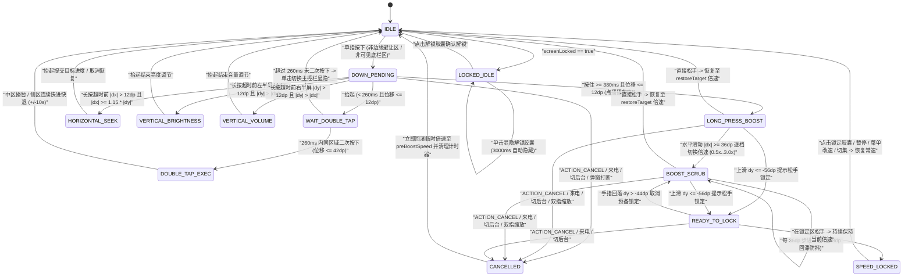
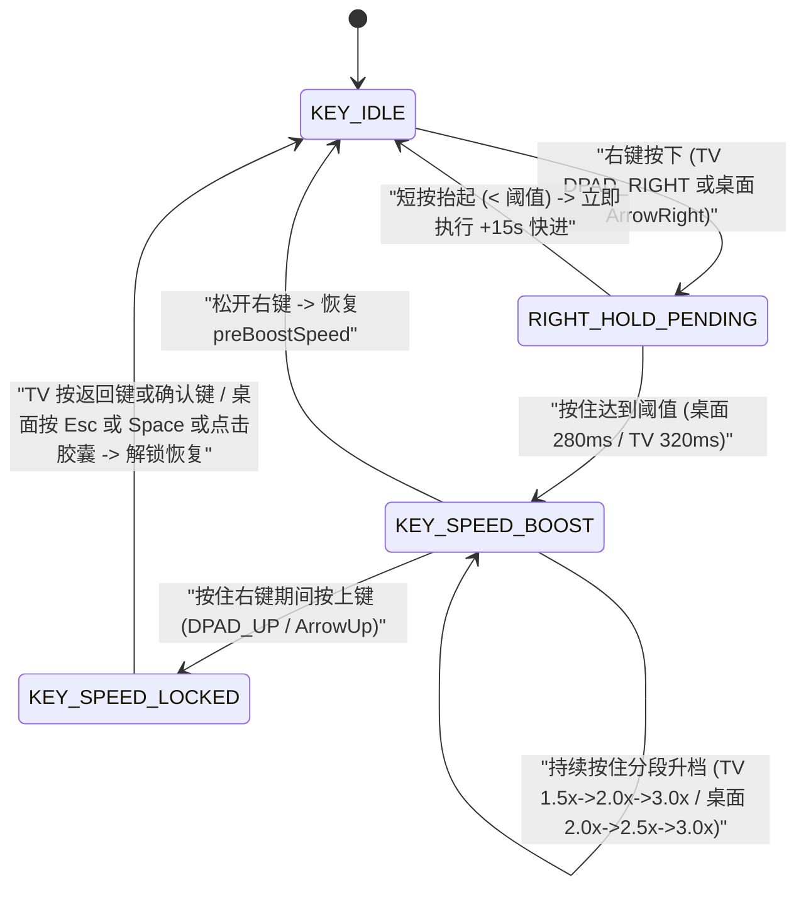

# 跨端播放页 HUD 与交互状态机规范（`player-hud-spec.md`）

> **适用里程碑**：M2（S21 Android 手机/平板、S22 Android 电视、S23 Flutter 桌面与 iOS/iPadOS）、R2 跨端评审。  
> **动效与样式引用**：所有动画时长、缓动曲线、弹簧参数及无障碍降级均引用同目录 `motion-tokens.json`；规格解析统一调用 M1 引擎与 `badge-rules.json`。

---

## 1. 设计目标与平台分级原则

1. **纯逻辑状态机与视图解耦**：将触控、遥控器方向键、桌面键鼠的输入判定收敛为无 UI 依赖的状态机（Android `PlayerGestureStateMachine.java`、Flutter `flutter/lib/ui/player/gesture_state_machine.dart`），在纯 JVM 与 `flutter test` 下可 100% 离线确定性单测；`TouchPlayerGesture.java`、`PlaybackControls.java`、`PlayerChrome.java` 与 `player_screen.dart` 仅保留最小事件转发与视图挂载。
2. **平台性能与只读边界守卫**：
   - **Android 电视（ARM32 Android 9 底线）**：HUD 背景严禁使用 `RenderEffect`、`BlurMaskFilter`、实时截图采样或片元着色器，统一采用高对比半透明纯色（`#D916161A` / 减少透明度时 `#F516161A`），确保 HUD 显隐与进度刷新稳定 `>= 50fps` 且零每帧对象分配。
   - **Flutter 桌面与 iOS/iPadOS**：沿用基线 `apple_theme.dart` 样式层；毛玻璃组件仅在 HUD 可见期间挂载渲染，隐藏态彻底跳过着色器与模糊管线。
   - **HarmonyOS NEXT 隔离约束**：所有新增 Flutter HUD 组件与手势扩展必须在入口处通过 `!OhosRuntime.isOhos` 门控默认关闭，对 `OhosPlatformPlayer` 缺失的 `videoParams` / `audioParams` 做空安全兜底，严禁修改 `flutter/ohos/` 与 `flutter/lib/ui/tv/**`。

---

## 2. 输入与手势状态机（Mermaid `stateDiagram-v2`）

### 2.1 触控端手势状态机（Android 手机/平板 & iOS/iPadOS）

### 2.2 电视遥控器与桌面键盘倍速/快进消歧状态机

---

## 3. 手势、遥控器与键鼠详细规则及默认参数

### 3.1 触控阈值、防误触区域与互斥规则

| 参数项 | 默认值 | 说明 |
| :--- | :--- | :--- |
| `touchSlop` | `12dp` / `12lp` | 区分静止长按与滑动手势的最小位移阈值 |
| `edgeBackExclusionHorizontal` | 左右边缘各 `24dp` / `24lp` | 触点落在此区域时状态机直接忽略，完全让渡给 iOS 侧滑返回（配合 `MobilePlayerChrome.setImmersive` 边缘延迟）与 Android 系统返回手势 |
| `systemInsetGuardVertical` | 顶部/底部各 `28dp` / `28lp` | 避让系统状态栏下拉与底部 Home 指示条上滑；主控栏展开时，触点落在顶部栏或底部 Dock 内（`startedInsideDock`）不触发播放面手势 |
| `doubleTapTimeoutMs` / `Slop` | `260ms` / `42dp` | 双击最大间隔与两次触点最大距离 |
| `doubleTapZoneSplit` | 左 `< 30%`、中 `30%–70%`、右 `> 70%` | 按视频交互层宽度划分左、中、右三区 |
| `doubleTapCenterAction` | 移动/平板 `"play_pause"`；桌面 `"fullscreen"` | 可选 `"play_pause"` / `"fullscreen"` / `"none"`（保持桌面基线双击全屏习惯） |
| `doubleTapSidesAction` | 移动/平板 `"seek_10s"`；桌面 `"fullscreen"` | 可选 `"seek_5s"` / `"seek_10s"` / `"seek_15s"` / `"play_pause"`；连续侧区双击在 `650ms` 内累加步进（如 `-10s -> -20s -> -30s`） |
| `longPressTriggerMs` | `380ms`（限制在 `350ms..450ms`） | 仅在点播（非直播）、非暂停、非锁屏时生效；触发瞬间进入 `2.0x`（若原速度已 `>= 2.0x` 则进入 `3.0x`） |
| `speedTiers` | `[0.5, 0.75, 1.0, 1.25, 1.5, 1.75, 2.0, 2.5, 3.0]` | 共 9 档；长按起始锚点对应当前触发档位 |
| `speedScrubStepDp` / `hysteresisDp` | `36dp` / `8dp` | 长按后水平每移动 `36dp` 升降 1 档；反向折返需越过 `8dp` 死区才跳档，消除手指微颤跳变 |
| `swipeUpLockTriggerDp` / `cancelDp` | `-56dp` / `-44dp` | 相对按下起点上滑达到 `56dp` 进入预备锁定态（胶囊文案变为 `"松手锁定 2.0×"`），回落至 `-44dp` 以下恢复普通倍速态 |
| `boostRestoreTarget` | `"pre_boost"`（默认） | 松手或解锁时恢复目标：`"pre_boost"`（恢复长按前用户设定的常驻倍速，与现有 `_normalSpeed` 一致）或 `"normal_1x"`（强制恢复 `1.0x`） |

**严格互斥与异常恢复契约**：
1. **单手势独占锁**：一旦从 `DOWN_PENDING` 进入 `HORIZONTAL_SEEK`、`VERTICAL_BRIGHTNESS`、`VERTICAL_VOLUME` 或 `LONG_PRESS_BOOST` 任一分支，立即取消其余分支定时器；同一次按压周期内绝不允许跨模式串扰（覆盖替换 `TouchPlayerGesture.java:283` 原有的固定拦截分支）。
2. **多指并发保护**：进入 `LONG_PRESS_BOOST` / `BOOST_SCRUB` 后，仅跟踪初始主触点 `activePointerId`；第二根手指按下时不跳变坐标；若主触点抬起则立即按松手处理；若触发双指缩放手势则立即执行 `CANCELLED` 恢复 `preBoostSpeed`。
3. **生命周期与焦点抢占恢复**：收到 `MotionEvent.ACTION_CANCEL`、`Activity.onPause()`、来电音频焦点丢失、`AppLifecycleState.inactive` / `paused`、或应用内弹出选集/设置对话框时，必须无条件退出临时加速并恢复 `preBoostSpeed`；切集（`step(1)` / `_stepEpisode`）时自动清除 `SPEED_LOCKED` 锁定态，回到常驻 `_normalSpeed`。

### 3.2 Android 电视端遥控器集成规则（`PlaybackController.java` & `InteractionProbe`）

1. **`dispatchPlaybackKey` 优先级链（解决 `TvMarkerHost` 上键冲突）**：
   - 现状（`PlaybackController.java:2026-2029`）：`!a.controlsVisible` 时，`KEYCODE_DPAD_UP` 会优先被 `a.playbackControls.markers().open(event)` 拦截以打开片头片尾标记面板。
   - **规范要求**：在 `dispatchPlaybackKey` 最前端插入 HUD 瞬态拦截判断：
     - 若当前处于 **遥控倍速按住态（`KEY_SPEED_BOOST`）**：按 `KEYCODE_DPAD_UP` 立即锁定当前倍速（进入 `KEY_SPEED_LOCKED`）并消费事件（`return true`），**不触发** `TvMarkerHost.open` 也不呼出工具栏；
     - 若当前处于 **倍速锁定态（`KEY_SPEED_LOCKED`）** 且工具栏隐藏：按 `KEYCODE_BACK` 或 `KEYCODE_DPAD_CENTER` / `KEYCODE_ENTER` 优先解除倍速锁定并恢复 `restoreTarget`（消费事件并提示 `"已恢复常速"`），**不直接退出播放器或暂停**；
     - 若当前显示 **跳过片头/片尾倒计时浮层**：按任意方向键（`UP` / `DOWN` / `LEFT` / `RIGHT`）或 `BACK` 视为取消本次自动跳过并归还焦点；按 `DPAD_CENTER` / `ENTER` 立即执行跳过；
     - 其余常规状态下，完整保留 `markers().open(event)` 与原有工具栏呼出逻辑。
2. **长按右键倍速 vs 原有长按快进预览（决策点 #1）**：
   - 新增偏好项 `Prefs.TV_HOLD_RIGHT_MODE`（整数：`0` = 长按右键逐级倍速，**默认 `0`**；`1` = 沿用原有 `SeekGesture` 长按右键加速快进预览）。左方向键 `DPAD_LEFT` 无论何种模式均保持短按 `-15s`、长按快退预览不变。
   - 当 `TV_HOLD_RIGHT_MODE == 0` 时：短按 `DPAD_RIGHT`（`< 320ms` 且 `repeatCount == 0` 抬起）执行 `+15s` 快进（兼容 `InteractionProbe.java:86-94` 短按断言）；按住 `>= 320ms` 进入 `1.5x` 倍速，持续按住满 `1200ms` 升至 `2.0x`，满 `2400ms` 升至 `3.0x`。
   - 对 `android/tests/device/InteractionProbe.java:96-135`：S22 验证时需同步验证 `TV_HOLD_RIGHT_MODE = 1` 下的原有长按快进探针不回归，并在说明中记录 `TV_HOLD_RIGHT_MODE = 0` 的倍速探针步骤。

### 3.3 桌面端键鼠集成规则（`player_screen.dart`）

1. **鼠标唤醒与自动隐藏**：指针在播放区域移动累计 `>= 12lp`（`350ms` 窗口内）时唤醒主控栏与鼠标光标；连续静止 `2500ms`（`desktopCursorIdleHide`，且未悬停在底栏/弹窗上）自动隐藏主控栏及鼠标指针。
2. **滚轮调节音量**：在视频表面 `Listener.onPointerSignal` 监听 `PointerScrollEvent`（排除弹窗/选集列表内部滚动）：向上滚动每次 `+5%`、向下滚动每次 `-5%`（范围 `0..100%`），顶部居中弹出轻量音量胶囊并在 `1200ms` 后淡出。
3. **`ArrowRight` 短按快进与长按倍速消歧（解决 `player_screen.dart:1878-1975` 冲突）**：
   - 移除原有的 `KeyDownEvent` 立即 `_seekRelative(15)` 调用，改为：
     - `KeyDownEvent(ArrowRight)`：记录按下时间戳并启动 `280ms`（`desktopHoldBoostThreshold`）定时器；
     - `< 280ms` 内收到 `KeyUpEvent(ArrowRight)`：取消定时器，立即执行 `_seekRelative(15)`，短按体感无损；
     - 按住满 `280ms`（或定时器触发）：进入 `2.0x` 倍速（满 `1500ms` 升至 `2.5x`，满 `2700ms` 升至 `3.0x`）；按住期间按 `ArrowUp` 进入倍速锁定态；松开 `ArrowRight` 时若未锁定则恢复 `_normalSpeed`。
     - `ArrowLeft` 维持 `KeyDown` / `KeyRepeat` 立即 `-15s` 快退。

---

## 4. 四大 HUD 子组件规范

### 4.1 起播规格提示（`StartSpecOverlay`）
- **触发时机**：每次新视频会话首帧渲染且轨道元数据稳定后（`STATE_READY` 且宽高 `> 0` 后延迟 `350ms` 聚合一次音视频轨道，同一集播放周期内仅自动弹出 1 次；用户可在设置 `player_start_spec_hud` 关闭，默认 `true`）。
- **位置与安全区避让**：
  - 位于画面**左上角安全区内**；若主控栏顶栏当前可见，则下移至顶栏下方 `12dp` 或待顶栏收起展示，绝不重叠。
  - Android：`left = max(dp(16), cutoutLeft + systemInsetLeft + dp(12))`，`top = max(dp(16), cutoutTop + systemInsetTop + dp(12))`。
  - Flutter（iOS 刘海 / 灵动岛横竖屏）：读取 `MediaQuery.viewPaddingOf(context)`，`left = max(16.0, viewPadding.left + 12.0)`，`top = max(16.0, viewPadding.top + 12.0)`。
- **数据融合契约**：
  - 优先采用播放器真实解码参数构造标准描述串（Android 统一升级 `MoviePlayer.mediaBadges()` 输出净室纯文字标签；Flutter 订阅 `player.stream.{width, height, track, tracks, videoParams, audioParams}`，在 `OhosPlatformPlayer` 上对 `videoParams`/`audioParams` 做空值保护），再补充线路名/文件名中的介质与发行平台信息（如 `REMUX`、`WEB-DL`、`NF`），交由 `MediaBadges` 去重排序后最多展示前 **5** 枚核心徽章。
- **时序**：`180ms` 淡入 -> 停留 `3000ms` -> `240ms` 淡出（`motion-tokens.json`）。

### 4.2 常驻细进度条（`SlimProgressBar`）
- **显隐条件**：默认开启（`player_slim_progress = true`）；仅在**点播视频（`duration > 0`）且完整主控栏隐藏（`!controlsVisible`）**时显示；主控栏唤起时 `150ms` 淡出，避免双进度条同屏。
- **几何与字幕避让**：贴底显示（高度手机/桌面 `2.5dp`/`2.5lp`，电视 `3.0dp`，左右对齐安全区内边距），不接收点击与焦点（`IMPORTANT_FOR_ACCESSIBILITY_NO` / `IgnorePointer`）。Android `SubtitleOverlayView` 默认底部边距（`caption.bottomMargin = 168dp` / `currentBottomDp >= 24dp`）及 Flutter 字幕层底部安全间距均远高于 `3dp`，互不遮挡。

### 4.3 跳过片头 / 片尾可取消倒计时（`SkipCountdownOverlay`）
- **数据源复用**：
  - Android：整合 `Prefs.SKIP_INTRO` / `Prefs.SKIP_OUTRO`（`0..180s`）、单剧集 `Prefs.VIDEO_SKIP_RECORDS` 与电视端 `TvMarkerHost` 标记。
  - Flutter：整合 `StorageService.getVideoSkipIntroSec` / `getVideoSkipOutroSec`（`0..600s`）及全局默认秒数。
- **交互逻辑**：
  - 新增模式开关 `player_skip_countdown`（布尔值，默认 `true` = 5 秒倒计时可取消；设为 `false` 则保持基线无感立即跳转）。
  - **片头**：从头起播（当前进度 `< skipIntroSec - 3s` 且非大于 `skipIntroSec` 的历史书签续播，总时长 `> skipIntroSec + 30s`）时，右下角安全区（底部主控栏上方 `28dp`）弹出胶囊 `"即将跳过片头 (5s) · [立即跳过] [取消]"`，每秒跳字 1 次，`5000ms` 结束自动 `seekTo(skipIntroSec)`。
  - **片尾**：当剩余时长 `<= skipOutroSec + 5s`（且 `skipOutroSec > 0`）时，弹出 `"即将跳过片尾 (5s) · [下一集] [取消]"`；倒计时归零触发既有切集/单集循环逻辑；本集内一旦点击 `[取消]`，本集不再重复弹出。
  - **电视焦点规范**：电视端浮层出现且工具栏隐藏时，`[立即跳过]` 自动获焦（应用 `tvFocus` 弹簧描边）；按确认键立即跳过，按任意方向键或返回键立即取消并关闭浮层。

### 4.4 定时关闭（`SleepTimer`）
- **档位**：`关闭`（默认）、`15 分钟`、`30 分钟`、`60 分钟`、`90 分钟`、`播完本集`。
- **会话生命周期**：仅对当前应用运行期生效（冷启动重置为 `关闭`，不跨会话持久化意外暂停）；倒计时归零前 `30s` 弹出轻提示 `"30 秒后将自动暂停 · [延长 15 分钟] [取消]"`，归零或本集结束时暂停播放器并释放屏幕常亮锁（`wakelock`）。
- **`Prefs.java` 与 `ReviewFixChecks.java` 兼容约束**：
  - `ReviewFixChecks.java:191` 强校验备份白名单 `Prefs.KEYS.length == 46`，`ReviewFixChecks.java:311` 强校验 `Prefs.sanitizeSetting(Prefs.PLAY_SPEED, 3.0) == null`。
  - M2 新增的本机 HUD 偏好键必须放在 `Prefs.KEYS` 数组**之外**（与 `PLAYER_ALWAYS_SHOW_CLOCK`、`TV_PLAYER_TOP_RIGHT_HUD` 同级），且持久化默认倍速 `Prefs.PLAY_SPEED` 保持 `0.5f..2.0f` 范围不变，仅在播放器运行时倍速菜单与长按调速状态机中开放 `0.5x..3.0x`。

---

## 5. 逐项验收标准（Acceptance Criteria）

1. **状态机离线覆盖**：Java 与 Dart 状态机单测需 100% 覆盖单击、三区双击、连续双击累加、长按 `2.0x`、横滑 `0.5x..3.0x` 档位步进与 `8dp` 回滞、上滑 `-56dp` 锁定、松手双模式恢复、与亮度/音量/进度拖动的严格互斥、边缘 `24dp` 避让、双指打断、后台/`ACTION_CANCEL` 恢复、切集解锁。
2. **电视端零掉帧与按键无冲突**：Android 9 ARM32 盒子上 HUD 显隐无模糊/无着色器，帧率 `>= 50fps`；未倍速时按上键仍正常打开 `TvMarkerHost`，倍速按住时按上键精准锁定倍速，锁定态按返回键先解锁而不直接退出播放器。
3. **桌面与 iOS 体验**：桌面鼠标静止 `2.5s` 自动隐去 HUD 与光标、滚轮调音量、`ArrowRight` 短按 `< 280ms` 精准 `+15s` 快进且长按 `>= 280ms` 平滑进入倍速；iPhone 横屏正反两个方向下左上角起播规格提示均严格避开刘海与灵动岛。
4. **无障碍与缩放**：开启「减少动态效果」时所有胶囊改为 `120ms` 纯透明度显隐；TalkBack / VoiceOver 可朗读倍速胶囊、解锁按钮、跳过倒计时与定时关闭剩余时长；Android 界面缩放 `100% / 110% / 120%` 下文字不裁切。

---

## 6. 不在范围内（Out of Scope）

1. **Android Lite（API 14）播放器改造**：Lite 维持现有极简播放控制，不引入手势状态机与新 HUD 层。
2. **Apple TV（`tvos/`）与鸿蒙智慧屏（`flutter/lib/ui/tv/**`、`flutter/ohos/`）**：目录只读，本轮不改动；Flutter 新增 HUD 在 `OhosRuntime.isOhos` 下默认关闭。
3. **拖动进度条视频缩略图雪碧图解码、端侧画面 OCR 广告/片头识别、独立后台纯音频「听视频」场景与外接副屏独立 UI**。
4. **弹幕轨道渲染与弹幕快捷开关接线**：由 `danmu-segment-protocol.md`（M3a / M3b）独立定义并在 M2 合入后挂载。
