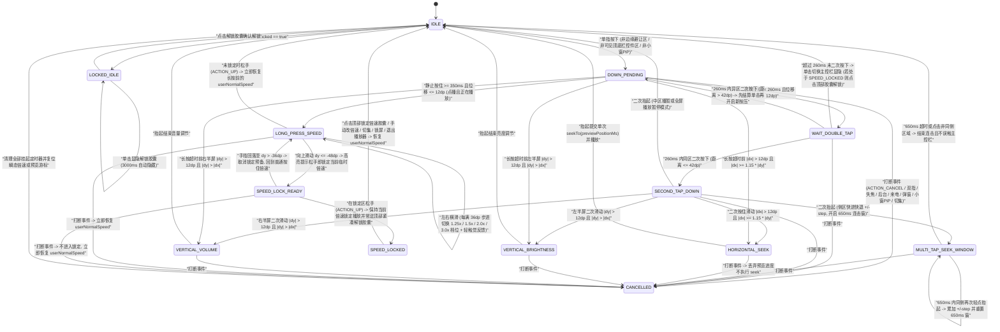
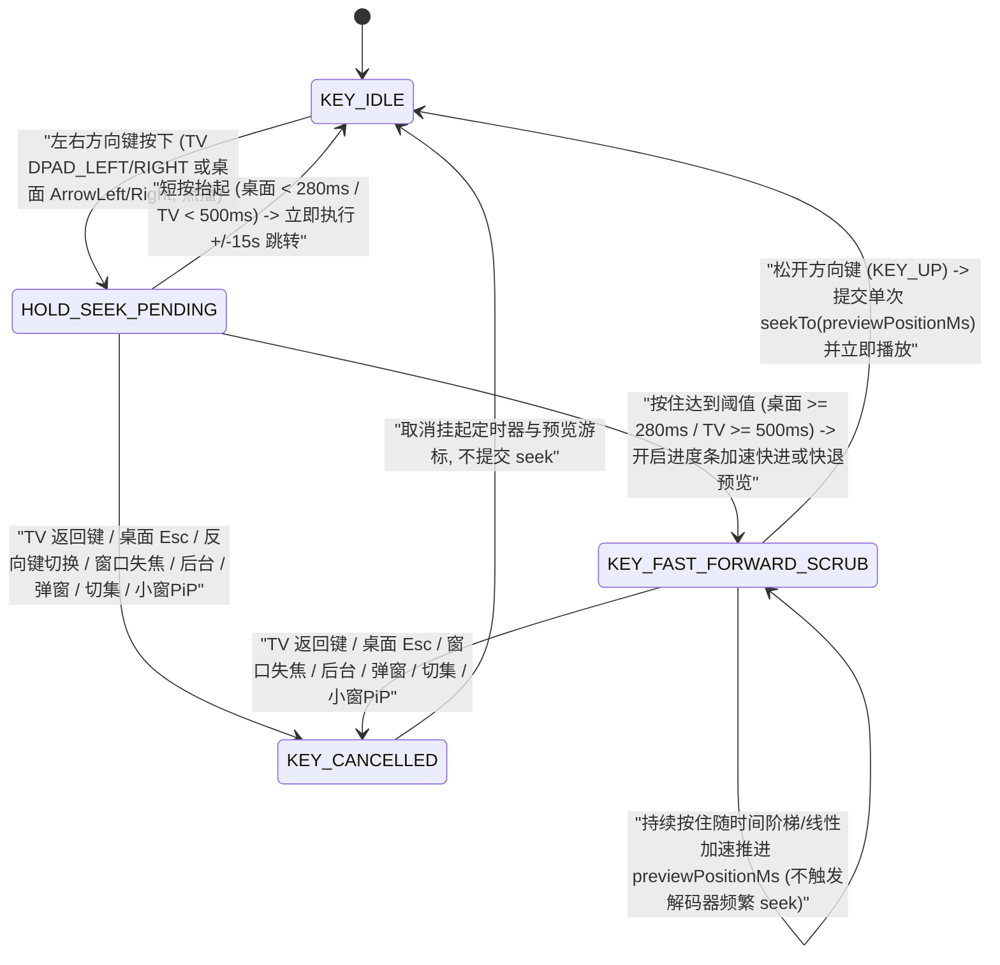

# 跨端播放页重构、HUD 与交互状态机规范（`player-hud-spec.md` · v2 基线对齐修订版）

> **适用里程碑**：Wave 1 · M2（S21 Android 手机/平板、S22 Android 电视、S23 Flutter 桌面与 **iOS/iPadOS 26 播放页统一重构**）、Gate 1 · R2 跨端评审。  
> **动效与样式引用**：所有动画时长、缓动曲线、弹簧参数、iOS 26 同心胶囊尺寸及无障碍降级均引用同目录 `motion-tokens.json`；规格解析统一调用 M1 引擎与 `badge-rules.json`。

---

## 1. 设计目标、各端基线优势保留与写入边界锁定

### 1.1 纯逻辑状态机与视图解耦
将触控、遥控器方向键、桌面键鼠的输入判定收敛为无 UI 依赖的状态机（Android `PlayerGestureStateMachine.java`、Flutter `flutter/lib/ui/player/gesture_state_machine.dart`），在纯 JVM 与 `flutter test` 下可 100% 离线确定性单测；`TouchPlayerGesture.java`、`PlaybackControls.java`、`PlayerChrome.java` 与 `player_screen.dart` 仅保留事件转发与模块化视图装配。

### 1.2 平台视觉统一、性能底线与 HarmonyOS 隔离守卫
- **iOS / iPadOS（`ios-v0.5.34` 基线原生 Liquid Glass 全局统一）**：
  - 基线 `aa0adb3acd` 已正式上线完整 iOS 26 原生液态玻璃体系（`flutter/lib/ui/ios_liquid_glass.dart` + `flutter/ios_native/MarcoLiquidGlass.swift`）。为彻底消除旧版播放页暗色混合控件与右侧 16 项拥挤滚动条带来的跨页面割裂感，M2 新建 `flutter/lib/ui/player/ios_player_chrome.dart` **重构 iOS/iPadOS 播放页**，采用**「同心胶囊空间影院 HUD + 原生 iOS 26 弹窗/半屏面板 + 零多 `UiKitView` 视频层切片」**架构（详见第 4.0 节）。
  - `glasswork.frag` 折射高光层**仅在 HUD 可见或显隐动画期间挂载运行**，HUD 隐藏态实现零着色器开销；iOS 15–18 设备及开启系统「降低透明度」时自动平滑切换至高对比半透明层。
- **Windows 桌面（Skia over ANGLE/D3D11）与 macOS 桌面（Impeller Metal）**：
  - Windows 端继续严格沿用 `apple_theme.dart` 中的 `winFastGlass` 半透明纯色高速面板（禁用实时模糊），保持窗口缩放与 4K 播放满帧；macOS 端采用桌面同心毛玻璃控制栏。
- **Android 电视（ARM32 Android 9 底线 + V17 影院规范）**：
  - HUD 背景严禁使用 `RenderEffect`、`BlurMaskFilter`、实时截图采样或片元着色器，统一采用高对比半透明纯色（`#D916161A` / 减少透明度时 `#F516161A`），确保 HUD 显隐与进度刷新稳定 `>= 50fps` 且零每帧对象分配。
- **HarmonyOS NEXT 隔离约束**：
  - 所有新增 Flutter HUD 组件、iOS 播放页重构层与手势扩展必须在入口处通过 `!OhosRuntime.isOhos` 门控默认关闭，对 `OhosPlatformPlayer` 缺失的 `videoParams` / `audioParams` 做空安全兜底，严禁修改 `flutter/ohos/` 与 `flutter/lib/ui/tv/**`。

### 1.3 Wave 1 / Wave 2 零冲突写入边界锁定表
1. **Android 播放器核心只读与唯一单行门控放宽**：
   - `MoviePlayer.java`、`SystemPlayer.java`、`SeekGesture.java` 与 `TvDetailHost.java` 保持**严格零修改**；
   - **`PlaybackController.java` 唯一允许的 1 行改动（`:1680`）**：允许将第 `1680` 行 `final boolean wantProgressOnly = !visible && a != null && a.isTvDevice() && canScrubProgress();` 的 `a.isTvDevice()` 条件放宽为兼顾手机/平板已开启 `player_slim_progress` 的场景，使移动端零重复代码直接复用原生 `progressOnlyMode` 常驻细进度条；`PlaybackController.java` 其余行严禁修改！
   - Android 起播规格提示直接消费现有的 `a.player.mediaBadges()` 纯文本列表与视频宽高，交由 M1 `MediaBadges` 做双通道融合；Android TV 左右方向键长按完整沿用 `PlaybackController.dispatchPlaybackKey`（`:2067-2083`）-> `SeekGesture`（`:62-101`）加速预览管线，与 `InteractionProbe.java` 100% 兼容且与 `:2026` `TvMarkerHost` 上键零冲突。
2. **测试脚本防冲突隔离**：Wave 1 中 M2 新增 Java 单测统一写入独立的 `android/tests/PlayerGestureChecks.java` 与 `android/tests/run_hud_checks.py`，Wave 1 期间**严禁修改 `android/tests/run_checks.py`**（留到 Wave 2 线 A 统一汇总接入）。
3. **本机偏好存储隔离（不入跨端备份表）**：新增 Android 本机偏好键独立通过 `SharedPreferences` 读写，严禁写入 `Prefs.java` 的 `Prefs.KEYS` 数组（保持 `ReviewFixChecks.java:191` 长度 `46` 与 `:311` 持久化 `PLAY_SPEED` 上限 `2.0f` 100% 不变）；Wave 1 中 Flutter HUD 偏好封装于 `flutter/lib/ui/player/player_hud_prefs.dart`，Wave 2 线 B 再通过 `IosNativeSwitch` 接入 `ios_settings.dart`。
4. **Wave 2 槽位预留**：M2 在 `PlaybackControls` / `PlayerChrome` 与 `player_screen.dart` / `ios_player_chrome.dart` 中预留弹幕层插槽、加载指示器插槽及首次播放提示浮层槽位（默认空），供 Wave 2 无冲突挂载 `DanmuLayer`、`BrandLogoLoader` 与 `FirstPlayGestureHint`。

---

## 2. 输入与手势状态机（Mermaid `stateDiagram-v2`）

### 2.1 触控端手势状态机（Android 手机/平板 & iOS/iPadOS — 保留并升级长按倍速）

> **防回归核心契约**：基线 `TouchPlayerGesture.java:154-169` 与 `player_screen.dart:2164-2186` 已上线「触控长按 2.0× 倍速」。本状态机完整保留该肌肉记忆，并无缝扩展为**「长按激活 2.0× 倍速 → 左右横滑实时切换倍速档位 → 上滑锁定倍速 → 未锁定时松手恢复原常驻倍速」**。

### 2.2 电视遥控器与桌面键盘快进/快退预览消歧状态机

---

## 3. 手势、遥控器与键鼠详细规则及默认参数

### 3.1 触控阈值、长按倍速调速锁定与防误触规则

| 参数 / 持久化键名 | 默认值 | 说明 |
| :--- | :--- | :--- |
| `touchSlop` | `12dp` / `12lp` | 区分静止长按/点击与滑动手势的最小位移阈值 |
| `edgeBackGuardHorizontal` | `max(24dp, systemGestureInsetLeft/Right)`（iOS `24lp`） | 触点落入左右系统侧滑区时状态机直接忽略，完全让渡给系统返回手势（配合 iOS `MobilePlayerChrome.setImmersive`） |
| `systemInsetGuardVertical` | 顶部/底部各 `28dp` / `28lp` | 避让系统栏手势；主控栏展开时，落在顶栏或底部胶囊坞内（`startedInsideDock`）不触发播放面手势 |
| `doubleTapTimeoutMs` / `Slop` | `260ms` / `42dp` | 必须在二次**抬起（`UP`）且位移 `<= 12dp`** 时触发双击，防止「单击紧接拖动」误判 |
| `player_double_tap_center` | 移动/平板 `"play_pause"`；桌面 `"fullscreen"` | 本机 snake_case 键名；可选 `"play_pause"` / `"fullscreen"` / `"none"` |
| `player_double_tap_sides` | 移动/平板 `"seek_10s"`；桌面 `"fullscreen"` | 可选 `"seek_5s"` / `"seek_10s"` / `"seek_15s"` / `"play_pause"`（播放设置面板一键切换回全屏双击播/暂）；进入 `MULTI_TAP_SEEK_WINDOW`（`650ms`）后每次同侧轻点直接累加步进，奇数次连击绝不误触主控栏显隐 |
| `touchHoldSpeedBoostThreshold` | **`350ms`** | 仅在点播（`durationMs > 0`）、非直播、非锁屏、非小窗/PiP 时生效；静止按住满 `350ms` 激活 **`LONG_PRESS_SPEED`**（初始临时倍速 **`2.0x`**，若长按前 `userNormalSpeed == 2.0x` 则自动升至 **`3.0x`**） |
| 横滑调速档位与步进 | 档位 **`[1.25x, 1.5x, 2.0x, 3.0x]`**；水平步距 **`36dp` / `36lp`** | 进入 `LONG_PRESS_SPEED` 后，以进入长按时的触点 `anchorX` 为基准，向右滑动升至 `3.0x`，向左滑动降至 `1.5x` / `1.25x`；每次跨档触发一次轻触觉反馈（`HapticFeedback.selectionClick` / `CLOCK_TICK`）并实时调用播放器倍速接口 |
| 上滑锁定阈值（`touchSwipeLockThresholdDp`） | **`dy <= -48dp` / `-48lp`**（回退滞回 `-36dp`） | 按住期间手指相对 `anchorY` 向上滑过 `48dp` 时，胶囊切换为高亮预备态 `"松手锁定 2.0× 播放"`；此时松手进入 **`SPEED_LOCKED`**，临时倍速不写入持久化配置，仅在当前集会话内保持，顶部居中常驻半透明紧凑胶囊 `"🔒 2.0× 锁定中 · 点击恢复"` |
| `player_long_press_restore_mode` | `"previous"`（恢复长按前 `userNormalSpeed`） | 可选 `"previous"`（默认恢复长按前用户设定的常驻倍速，如 `1.25x`）或 `"1.0x"`（强制恢复 `1.0x`） |

**全状态互斥与异常打断契约**：
1. **单手势独占**：一旦进入 `HORIZONTAL_SEEK`、`VERTICAL_BRIGHTNESS`、`VERTICAL_VOLUME` 或 `LONG_PRESS_SPEED` 任一分支，立即取消其余分支定时器；直接水平滑动进度条（`HORIZONTAL_SEEK`）按住期间仅更新进度游标与时间预览胶囊，松手瞬间才提交单次 `seekTo`（零解码寻道卡顿）。
2. **打断强制安全复位**：按住倍速或滑动进度期间若发生 `ACTION_CANCEL`、第二根手指按下、`Activity.onPause()`、`onWindowFocusChanged(false)`、来电/音频焦点丢失、`AppLifecycleState.inactive` / `paused`、进入 `a.miniMode` 或系统 PiP、弹出应用内面板 `dialogOpen`、切换选集 `StepEpisode`，均立即转入 `CANCELLED -> IDLE`：**恢复 `userNormalSpeed` 且丢弃未提交的拖动进度**，绝不遗留异常高倍速或误跳转。

### 3.2 Android 电视端遥控器集成规则（零改动复用 `PlaybackController` & `SeekGesture`）

1. **100% 兼容既有遥控管线与 `InteractionProbe`**：
   - 基线 `PlaybackController.dispatchPlaybackKey`（`:2067-2083`）与 `SeekGesture.java`（`:62-101`）已原生实现：短按 `DPAD_RIGHT` / `DPAD_LEFT`（`< 500ms`）精准跳转 `±15s`；按住满 `500ms` 线性加速推进 `a.seekGesture.target`（按住期间零网络/解码 `seekTo`），按 `KEYCODE_BACK` 或失焦取消预览，松开按键提交单次 `seekTo(target)`；`KEYCODE_DPAD_UP`（`:2026-2029`）继续专用于 `TvMarkerHost.open(event)`。
2. **S22 视觉层升级契约**：
   - S22 在 `PlaybackControls.java`、`PlayerChrome.java` 与新建 `hud/FastForwardScrubCapsule.java` 中挂载大字号无模糊预览胶囊（读取 `a.seekGesture.target` 显示目标时间与偏移量），同时完整保留 `a.playbackControls.timeline.setProgress(a.seekGesture.target)` 与 `a.playStatus` 中的 `"加速"` 文案更新，确保 `InteractionProbe.java:86-147` 全部 7 项遥控探针断言原样通过。

### 3.3 桌面端键鼠集成规则（`player_screen.dart` & `TvRemoteSeekController` 协同）

1. **鼠标唤醒与滚轮音量**：指针移动累计 `>= 12lp`（`350ms` 内）唤醒 HUD 与光标，静止 `2500ms` 自动隐藏；播放面 `Listener.onPointerSignal` 监听 `PointerScrollEvent` 每次 `±5%` 调节音量（`0..100%`）。
2. **`KeyUpEvent` 放行、方向键快进预览与快捷键分工**：
   - 修正 `player_screen.dart:1875` 放行 `KeyUpEvent` 进入桌面键盘控制器（与 `video_kernel.dart:578` `TvRemoteSeekController` 保持语义一致，避免双重重复触发）：短按 `ArrowLeft` / `ArrowRight`（`< 280ms`）跳转 `±15s`；按住 `>= 280ms` 进入 `KEY_FAST_FORWARD_SCRUB` 推进进度条预览游标，松开按键执行单次 `seek(previewPositionMs)`，按 `Escape` 优先抢占取消预览而不退出全屏。
   - **桌面倍速与弹幕单键**：保留 `[` / `]` 步进调整常驻倍速，新增 **`S` 键**快速循环常用倍速档位（`1.0x -> 1.25x -> 1.5x -> 2.0x -> 1.0x`），预留 **`D` 键**供 Wave 2 挂载弹幕开关（输入框获焦时不触发）。

---

## 4. iOS 26 播放页统一重构与五大 HUD 子组件规范

### 4.0 iOS / iPadOS 26 空间影院播放页重构规范（`flutter/lib/ui/player/ios_player_chrome.dart`）

为使播放页与首页底部 `ios26_dock`、搜索页 `ios_search_page.dart` 及详情页 `detail_screen.dart` 的原生 iOS 26 Liquid Glass 语言完全统一，同时规避在 60fps 视频 `Texture` 上散落创建十余个 `UiKitView` 导致的 Impeller 图层切片与截图黑洞，S23 必须按以下混合架构重构 iOS/iPadOS 播放页控制层：

1. **三段式同心液态玻璃空间布局（废弃旧版右侧 16 项拥挤竖条 `_buildScrollableToolDock`）**：
   - **顶部悬浮同心栏（Top Spatial Header）**：
     - 左侧：`40pt` 高同心胶囊玻璃返回键（`borderRadius = 20pt`，高光细描边与色温对齐 `MarcoInteractiveCircleGlassControl`）；
     - 中部：单行高对比片名 + 副标题（集数 · 线路名）+ **整合式动态媒体规格徽章行**（起播首帧就绪后展开显示前 5 枚同心胶囊徽章如 `4K`、`DV · ATMOS`、`HDR10+`，3 秒后柔和收拢为精简主规格胶囊常驻标题旁，彻底消除左上角悬浮卡片与返回键碰撞重叠的问题）；
     - 右侧：`40pt` 圆形玻璃快捷按钮组（最多 3 枚：`弹幕开关`、`音轨与字幕`、`更多与定时 …`，竖屏窄宽度下自动折叠进 `…`）。
   - **中央空间播控组（Center Refractive Transport）**：
     - 居中排列 `56pt`（快退 15s）、`76pt`（播放/暂停主视觉圆钮）、`56pt`（快进 15s）三枚完美圆形折射玻璃按钮（直播流仅保留中央 `76pt` 播放/暂停），按下时具备 `pressFeedback`（`response = 0.16s`）微缩回弹反馈。
   - **底部流体进度与精简胶囊坞（Bottom Fluid Scrubber & Action Capsule Dock）**：
     - 第一层——**流体伸缩进度胶囊（Fluid Expanding Scrubber）**：空闲展开态轨道高度为 `5pt`；当手指按下或水平拖动进度时，轨道通过 `hudPopup` 弹簧平滑膨胀至 `10pt` 高亮发光胶囊，两侧等宽数字（`tabularFigures`）实时显示当前/预览时间与剩余时长，并绘制片头/片尾跳过锚点刻度；
     - 第二层——**精简高频操作胶囊条**：横屏居中限宽悬浮、竖屏贴合安全区，仅保留最高频的 `<= 7` 项胶囊按钮（`选集`、`线路`、`倍速 1.0×`、`弹幕设置`、`画面/策略`、`锁屏`、`全屏/旋转`），低频开关（连播、循环、常驻时钟、跳过片头秒数设置、重播）统一收纳进顶栏右侧 `…` 菜单。
2. **原生 iOS 26 弹窗与半屏面板深度联动（`MarcoLiquidGlass.swift` & `ios_liquid_glass.dart`）**：
   - 在 `IosLiquidGlassBridge.isAvailable == true`（iOS 26+）时，点击 `倍速`、`定时关闭`、`画面/策略`、`音轨`、`字幕` 或顶栏 `…` 菜单，优先调用 `showAppleNativeActionSheet` 或扩展 `MarcoLiquidGlass.swift` 原生 `UISheetPresentationController` 半屏选择器（复用现有 `checked` 勾选态与 `subtitle` 能力）；
   - iOS 15–18 设备自动回退至同配色的 `AppleModalSheet` Flutter 毛玻璃半屏面板；
   - 在 `MarcoLiquidGlass.swift` 的 `capabilities` 返回字典中新增 `"reduceTransparency": UIAccessibility.isReduceTransparencyEnabled`（并在 `UIApplicationWillEnterForegroundNotification` / 无障碍变更通知时刷新），使 `ios_player_chrome.dart` 与 `MediaBadge` 同步遵循系统「降低透明度」设置；
   - 在 `ios_liquid_glass.dart` 新增静态辅助方法 `IosNativeRouteGate.runWithPlaceholders<T>(Future<T> Function() action)`，供 Wave 2 详情页进入播放器执行 `RepaintBoundary.toImage()` 前单帧将 `UiKitView` 替换为等尺寸 Flutter 玻璃占位符，彻底消除转场纹理中的原生控件黑洞。

### 4.1 起播规格提示与动态徽章融合（`StartSpecOverlay`）
- **触发与防遮挡布局**：点播首帧渲染且宽高 `> 0` 后延迟 `350ms` 触发 1 次（键名 `player_start_spec_hud`，默认 `true`）：
  - 若此时主控顶栏处于**隐藏态**：在左上角安全区内侧（Android `left = max(dp(16), max(cutoutLeft, systemInsetLeft) + dp(12))`、`top = max(dp(16), max(cutoutTop, systemInsetTop) + dp(12))`；Flutter `left = max(16.0, viewPadding.left + 12.0)`、`top = max(16.0, viewPadding.top + 12.0)`）淡入展示 `3000ms` 后 `240ms` 淡出；
  - 若此时主控顶栏处于**可见态**（或展示中途用户唤醒了顶栏）：规格徽章直接内联展示在顶栏标题右侧的徽章槽位（Android `PlayerChrome.badgeRow` / Flutter `ios_player_chrome` 标题徽章行），左上方独立浮层立即隐去或下移至顶栏下方（`topHeaderBottom + 10dp`），**绝不与左上角返回按钮发生任何像素重叠**。
- **双通道分组安全融合契约**：
  1. **通道 A（`M_track`）**：单独对实时轨道描述串执行 `MediaBadges` 匹配（Android 拼合 `a.player.mediaBadges()` 与实时 `videoWidth x videoHeight`；Flutter 从 `tracks` / `videoParams` / `audioParams` 提取，对 `OhosPlatformPlayer` 判空兜底）。
  2. **通道 B（`M_meta`）**：单独对当前线路名与原始剧集名/文件名执行 `MediaBadges` 匹配。
  3. **按组安全合并（`M_merged`）**：只要已知真实视频宽高（`w > 0 && h > 0`），`resolution` 组严格只取 `M_track`（防止 `"4K专线"` 误标低清流，也防止 `"4K/1080P自适应"` 压制真实 `4K` 流）；`source_quality` 与 `release_platform` 取自 `M_meta`；其余组优先采用 `M_track`，缺失时补充兼容的 `dr_dv` / `aud_atmos`；最后执行一次 `comboRules` 合成并按 `(priority ASC, id ASC)` 排序展示前 **5** 枚徽章。

### 4.2 常驻细进度条（`SlimProgressBar`）
- 键名 `player_slim_progress`（默认 `true`）；仅在点播（`duration > 0`）、非小窗/PiP 且完整主控栏隐藏（`!controlsVisible`）时贴底显示（移动/桌面 `2.5dp`/`2.5lp`，电视 `3.0dp`）；Android 手机端直接通过放宽 `PlaybackController.java:1680` 门控复用原生细进度条；主控栏展开时 `150ms` 淡出，不遮挡字幕层。

### 4.3 倍速调节与上滑锁定胶囊（`SpeedCapsule`）
- 长按进入 `LONG_PRESS_SPEED` 时在屏幕上方居中（安全区下 `16dp`/`16lp`）弹出高对比胶囊：第一行动态显示 `"⏩ 2.0× 倍速播放中"`（随横滑实时跳变 `1.25× / 1.5× / 2.0× / 3.0×` 档位刻度点），第二行副标题显示 `"左右滑动调速 · 上滑锁定"`；
- 上滑越过 `-48dp` 时副标题高亮为 `"松手即可锁定 2.0×"`；松手进入 `SPEED_LOCKED` 后收缩为紧凑可点击胶囊 `"🔒 2.0× 锁定中 · 点击恢复"`（3 秒后自动降为 `0.72` 低干扰不透明度，轻点胶囊立即恢复 `userNormalSpeed`）。

### 4.4 跳过片头 / 片尾 3 秒可取消倒计时（`SkipCountdownOverlay`）
- 键名 `player_skip_countdown`（布尔值，默认 **`true` = `3000ms` 可取消倒计时**；设为 `false` 切换为静默立即跳转），复用 Android `Prefs.SKIP_INTRO/OUTRO` / `VIDEO_SKIP_RECORDS` / `TvMarkerHost` 与 Flutter `StorageService.getVideoSkipIntroSec/OutroSec`。
- **Android TV 零侵入焦点路由**：电视端倒计时卡片出现且主工具栏隐藏时，置 `a.playbackControls.dialogOpen = true` 并让 `[立即跳过]` 按钮请求焦点：按确认键立即跳过，按任意方向键或返回键立即取消，关闭瞬间重置 `dialogOpen = false` 并将焦点归还 `a.root`。

### 4.5 定时关闭（`SleepTimer`）
- 会话级档位：`关闭`（冷启动默认）、`15m`、`30m`、`60m`、`90m`、`播完本集`；归零前 `30s` 顶部轻量提示可延长 `15m` 或取消，到点暂停播放并释放常亮锁。

---

## 5. 逐项验收标准（Acceptance Criteria）

1. **触控长按倍速全链路与零死锁**：Java 与 Dart 状态机单测 100% 覆盖单击、二次抬起双击、侧区 `650ms` 连击累加不闪工具栏、静止长按 `350ms` 激活 `2.0x` 倍速 → 左右横滑切换 `1.25x/1.5x/2.0x/3.0x` → 上滑 `-48dp` 松手锁定 → 点击胶囊或切集/锁屏解锁恢复原速、以及双指/来电/切后台/弹窗/PiP 打断下 `100%` 恢复 `userNormalSpeed`。
2. **iOS 26 统一液态玻璃播放页品质**：iPhone / iPad 播放页同心胶囊圆角、高光描边、流体 `5pt->10pt` 进度条与精简胶囊坞同首页/详情页视觉完全统一；活跃视频纹理上无散落多 `UiKitView` 切片；`glasswork.frag` 隐藏态零开销；iOS 26 原生菜单/半屏面板、`reduceTransparency` 与 iOS 15–18 回退均正常工作。
3. **电视端与桌面端零退化**：Android 9 ARM32 盒子 HUD 全程 `>= 50fps`（零模糊/零着色器），`InteractionProbe` 全部遥控断言与 `TvMarkerHost` 上键呼出 100% 通过，`PlaybackController.java` 仅第 1680 行单行变动；桌面端短按 `±15s`、长按快进预览、`Esc` 取消预览、`S` 倍速键与 Windows `winFastGlass` 正常。
4. **防遮挡与双通道防误标**：起播规格提示与左上角返回胶囊在任何横竖屏/刘海/灵动岛状态下零重叠；`960x540` 视频配 `"4K专线"` 绝不误标 `4K`。

---

## 6. 不在范围内（Out of Scope）

1. **Android Lite（API 14）播放器改造**、**Apple TV（`tvos/`）** 与 **鸿蒙智慧屏（`flutter/lib/ui/tv/**`、`flutter/ohos/`）**。
2. **修改 `MoviePlayer.java` / `SystemPlayer.java` / `SeekGesture.java` / `TvDetailHost.java`（以及 `PlaybackController.java` 除第 1680 行外的任何代码）、视频缩略图雪碧图、端侧画面 OCR 跳过、纯音频后台场景与外接副屏 UI**。
3. **弹幕轨道渲染引擎与播放器接线**：分别在 Wave 1 · M3a（独立核心与渲染层）与 Wave 2（M3b 薄接线）中按 `danmu-segment-protocol.md` 执行。
