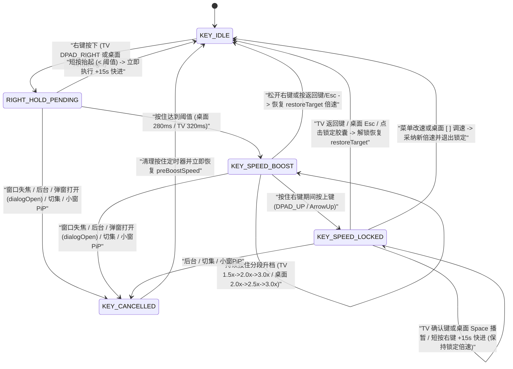

# 跨端播放页 HUD 与交互状态机规范（`player-hud-spec.md`）

> **适用里程碑**：M2（S21 Android 手机/平板、S22 Android 电视、S23 Flutter 桌面与 iOS/iPadOS）、R2 跨端评审。  
> **动效与样式引用**：所有动画时长、缓动曲线、弹簧参数及无障碍降级均引用同目录 `motion-tokens.json`；规格解析统一调用 M1 引擎与 `badge-rules.json`。

---

## 1. 设计目标、平台分级与 §4.1 写入边界对齐

### 1.1 纯逻辑状态机与视图解耦
将触控、遥控器方向键、桌面键鼠的输入判定收敛为无 UI 依赖的状态机（Android `PlayerGestureStateMachine.java`、Flutter `flutter/lib/ui/player/gesture_state_machine.dart`），在纯 JVM 与 `flutter test` 下可 100% 离线确定性单测；`TouchPlayerGesture.java`、`PlaybackControls.java`、`PlayerChrome.java` 与 `player_screen.dart` 仅保留最小事件转发与视图挂载。

### 1.2 平台性能与 HarmonyOS 隔离守卫
- **Android 电视（ARM32 Android 9 底线）**：HUD 背景严禁使用 `RenderEffect`、`BlurMaskFilter`、实时截图采样或片元着色器，统一采用高对比半透明纯色（`#D916161A` / 减少透明度时 `#F516161A`），确保 HUD 显隐与进度刷新稳定 `>= 50fps` 且零每帧对象分配。
- **Flutter 桌面与 iOS/iPadOS**：沿用基线 `apple_theme.dart` 样式层；毛玻璃组件仅在 HUD 可见期间挂载渲染，隐藏态彻底跳过着色器与模糊管线。
- **HarmonyOS NEXT 隔离约束**：所有新增 Flutter HUD 组件与手势扩展必须在入口处通过 `!OhosRuntime.isOhos` 门控默认关闭，对 `OhosPlatformPlayer` 缺失的 `videoParams` / `audioParams` 做空安全兜底，严禁修改 `flutter/ohos/` 与 `flutter/lib/ui/tv/**`。

### 1.3 下游里程碑写入边界协同（对齐 `teamwork_execution_plan.md` §4.1）
1. **`MoviePlayer.java` 与 `SystemPlayer.java` 严格只读**：M2 不修改任何播放器解码内核文件；Android 起播规格提示直接读取现有的 `a.player.mediaBadges()` 纯文本列表及视频宽高，交由 M1 `MediaBadges` 做双通道融合。
2. **M2 电视遥控按键最小接线（`PlaybackController.java`）**：`PlaybackController.dispatchPlaybackKey`（`:2020-2097`）顶部无现成前置委托钩子，S22 需在其入口处增加最小委托调用（含 `:2024` `dialogOpen` 分支前的倍速状态清理），已同步列入 M0 决策点供 Wave 1 §4.1 白名单确认。
3. **M1 Lite 详情页最小接线（`LiteActivity.java`）**：S12 除新建 `LiteBadges.java` 外，仅在 `LiteActivity.java` 详情页元数据行（`:3977`）与线路胶囊（`:4114`）做纯文本拼接挂载。
4. **M2 Flutter HUD 偏好自包含存储**：在 `flutter/lib/ui/player/` 内新建轻量偏好辅助类直接读写 `SharedPreferences`，并在 `player_screen.dart` 播放内设置面板暴露开关，不触碰 `storage_service.dart` 与 `ios_settings.dart`。
5. **M5 首次播放提示槽位预留**：M2 在 `PlayerChrome` 与 `player_screen.dart` 预留可选的轻量浮层构建槽位（默认空），供 Wave 3 · M5（S52 / S53）注入 `FirstPlayGestureHint` 而不修改播放器内部代码。

---

## 2. 输入与手势状态机（Mermaid `stateDiagram-v2`）

### 2.1 触控端手势状态机（Android 手机/平板 & iOS/iPadOS）

```mermaid
stateDiagram-v2
    [*] --> IDLE

    IDLE --> LOCKED_IDLE : "screenLocked == true"
    LOCKED_IDLE --> IDLE : "点击解锁胶囊确认解锁"
    LOCKED_IDLE --> LOCKED_IDLE : "单击显隐解锁胶囊 (3000ms 自动隐藏)"

    IDLE --> DOWN_PENDING : "单指按下 (非边缘避让区 / 非可见底栏区 / 非小窗PiP)"
    DOWN_PENDING --> WAIT_DOUBLE_TAP : "首次抬起 (< 260ms 且位移 <= 12dp)"
    WAIT_DOUBLE_TAP --> IDLE : "超过 260ms 未二次按下 -> 单击切换主控栏显隐"
    WAIT_DOUBLE_TAP --> DOWN_PENDING : "260ms 内异区二次按下 (距离 > 42dp) -> 先结算单击再开启新按压"
    WAIT_DOUBLE_TAP --> SECOND_TAP_DOWN : "260ms 内同区二次按下 (距离 <= 42dp)"

    SECOND_TAP_DOWN --> HORIZONTAL_SEEK : "二次按住滑动 |dx| > 12dp 且 |dx| >= 1.15 * |dy|"
    SECOND_TAP_DOWN --> VERTICAL_BRIGHTNESS : "左半屏二次滑动 |dy| > 12dp 且 |dy| > |dx|"
    SECOND_TAP_DOWN --> VERTICAL_VOLUME : "右半屏二次滑动 |dy| > 12dp 且 |dy| > |dx|"
    SECOND_TAP_DOWN --> IDLE : "二次抬起 (中区播暂或全屏切换)"
    SECOND_TAP_DOWN --> MULTI_TAP_SEEK_WINDOW : "二次抬起 (侧区快进快退 +/-step, 开启 650ms 连击窗)"

    MULTI_TAP_SEEK_WINDOW --> MULTI_TAP_SEEK_WINDOW : "650ms 内同侧再次轻点抬起 -> 累加 +/-step 并重置 650ms 窗"
    MULTI_TAP_SEEK_WINDOW --> IDLE : "650ms 超时或点击非同侧区域 -> 结束连击且不误触主控栏"

    DOWN_PENDING --> HORIZONTAL_SEEK : "长按超时前 |dx| > 12dp 且 |dx| >= 1.15 * |dy|"
    HORIZONTAL_SEEK --> IDLE : "抬起提交目标进度"

    DOWN_PENDING --> VERTICAL_BRIGHTNESS : "长按超时前左半屏 |dy| > 12dp 且 |dy| > |dx|"
    VERTICAL_BRIGHTNESS --> IDLE : "抬起结束亮度调节"

    DOWN_PENDING --> VERTICAL_VOLUME : "长按超时前右半屏 |dy| > 12dp 且 |dy| > |dx|"
    VERTICAL_VOLUME --> IDLE : "抬起结束音量调节"

    DOWN_PENDING --> LONG_PRESS_BOOST : "按住 >= 380ms 且位移 <= 12dp (点播播放中)"
    LONG_PRESS_BOOST --> BOOST_SCRUB : "水平滑动 |dx| >= 36dp 逐档切换倍速 (0.5x..3.0x)"
    BOOST_SCRUB --> BOOST_SCRUB : "每 36dp 步进一档 (含 8dp 回滞防抖)"
    LONG_PRESS_BOOST --> READY_TO_LOCK : "上滑 dy <= -56dp 提示松手锁定"
    BOOST_SCRUB --> READY_TO_LOCK : "上滑 dy <= -56dp 提示松手锁定"
    READY_TO_LOCK --> BOOST_SCRUB : "手指回落 dy > -44dp 取消预备锁定"

    LONG_PRESS_BOOST --> IDLE : "直接松手 -> 恢复至 restoreTarget 倍速"
    BOOST_SCRUB --> IDLE : "直接松手 -> 恢复至 restoreTarget 倍速"
    READY_TO_LOCK --> SPEED_LOCKED : "在锁定区松手 -> 持续锁定当前倍速"

    SPEED_LOCKED --> SPEED_LOCKED : "播暂切换 (暂停或继续均保留 SPEED_LOCKED 锁定倍速)"
    SPEED_LOCKED --> IDLE : "点击锁定胶囊 -> 恢复 restoreTarget 倍速"
    SPEED_LOCKED --> IDLE : "倍速菜单手动选速 -> 采纳所选新倍速为常驻速度并解除锁定"
    SPEED_LOCKED --> IDLE : "切集 (StepEpisode) -> 恢复常驻 normalSpeed"

    DOWN_PENDING --> CANCELLED : "打断事件 (ACTION_CANCEL / 失焦 / 后台 / 来电 / 弹窗 / 小窗PiP / 双指)"
    WAIT_DOUBLE_TAP --> CANCELLED : "打断事件"
    SECOND_TAP_DOWN --> CANCELLED : "打断事件"
    MULTI_TAP_SEEK_WINDOW --> CANCELLED : "打断事件"
    HORIZONTAL_SEEK --> CANCELLED : "打断事件"
    VERTICAL_BRIGHTNESS --> CANCELLED : "打断事件"
    VERTICAL_VOLUME --> CANCELLED : "打断事件"
    LONG_PRESS_BOOST --> CANCELLED : "打断事件"
    BOOST_SCRUB --> CANCELLED : "打断事件"
    READY_TO_LOCK --> CANCELLED : "打断事件"
    SPEED_LOCKED --> CANCELLED : "生命周期打断 (后台 / 来电 / 小窗PiP)"
    CANCELLED --> IDLE : "取消挂起定时器并回滚临时倍速至 preBoostSpeed"
```

### 2.2 电视遥控器与桌面键盘倍速/快进消歧状态机

---

## 3. 手势、遥控器与键鼠详细规则及默认参数

### 3.1 触控阈值、持久化键名与异常恢复契约

| 参数 / 持久化键名 | 默认值 | 说明 |
| :--- | :--- | :--- |
| `touchSlop` | `12dp` / `12lp` | 区分静止长按/点击与滑动手势的最小位移阈值 |
| `edgeBackGuardHorizontal` | `max(24dp, systemGestureInsetLeft/Right)`（iOS `24lp`） | 触点落入左右系统侧滑区时状态机直接忽略，让渡给系统返回手势（配合 iOS `MobilePlayerChrome.setImmersive`） |
| `systemInsetGuardVertical` | 顶部/底部各 `28dp` / `28lp` | 避让系统栏手势；主控栏展开时，落在顶栏或底部 Dock 内（`startedInsideDock`）不触发播放面手势 |
| `doubleTapTimeoutMs` / `Slop` | `260ms` / `42dp` | 双击最大间隔与两次触点最大距离；必须在二次**抬起（`UP`）且位移 `<= 12dp`** 时才触发双击，防止「单击紧接拖动」误判为双击 |
| `player_double_tap_center` | 移动/平板 `"play_pause"`；桌面 `"fullscreen"` | 跨端统一 snake_case 键名；可选 `"play_pause"` / `"fullscreen"` / `"none"` |
| `player_double_tap_sides` | 移动/平板 `"seek_10s"`；桌面 `"fullscreen"` | 可选 `"seek_5s"` / `"seek_10s"` / `"seek_15s"` / `"play_pause"`；进入 `MULTI_TAP_SEEK_WINDOW`（`650ms`）后每次同侧轻点直接累加步进，第 3/5 次奇数点击绝不回落 `WAIT_DOUBLE_TAP` 误触主控栏显隐 |
| `longPressTriggerMs` | `380ms`（限制 `350ms..450ms`） | 仅在点播（非直播）、播放中、非锁屏、非小窗/PiP 时生效；起始进入 `2.0x`（原速已 `>= 2.0x` 则进入 `3.0x`） |
| `speedTiers` | `[0.5, 0.75, 1.0, 1.25, 1.5, 1.75, 2.0, 2.5, 3.0]` | 共 9 档；每水平移动 `36dp` 步进 1 档，反向折返带 `8dp` 回滞死区 |
| `swipeUpLockTriggerDp` / `cancelDp` | `-56dp` / `-44dp` | 相对起点上滑 `<= -56dp` 进入 `READY_TO_LOCK`（提示 `"松手锁定 {speed}×"`），回落 `> -44dp` 退回调速态 |
| `player_boost_restore_target` | `"pre_boost"`（默认） | 可选 `"pre_boost"`（恢复长按前用户设定的常驻倍速 `_normalSpeed`）或 `"normal_1x"`（恢复 `1.0x`） |

**严格互斥、倍速锁定与异常恢复契约**：
1. **单手势独占锁**：一旦从 `DOWN_PENDING` 或 `SECOND_TAP_DOWN` 进入拖动或倍速分支，立即取消其余分支定时器，同一次按压周期内严禁串扰。
2. **`SPEED_LOCKED` 与播暂/菜单协同**：锁定倍速期间，用户执行暂停/继续（触控按钮、中区双击、TV 确认键、桌面 `Space`）**仅切换播放/暂停而不解除锁定**，恢复播放后延续锁定倍速；若用户在倍速菜单手动选择新倍速（或桌面按 `[` / `]`），则**直接采纳新倍速更新 `_normalSpeed` 并清除锁定标记**（绝不用旧 `restoreTarget` 覆盖新选倍速）。
3. **全状态打断兜底（含 `miniMode` 与 PiP）**：收到 `ACTION_CANCEL`、`Activity.onPause()`、`onWindowFocusChanged(false)`（如下拉系统通知栏）、音频焦点丢失/来电、`AppLifecycleState.inactive` / `paused`、进入应用内小窗 `a.miniMode`、进入系统画中画 `onPictureInPictureModeChanged(true)`、弹出应用内对话框 `dialogOpen` 或双指缩放时，任何非 `IDLE` 状态均立即经 `CANCELLED` 清理定时器并回滚临时倍速至 `preBoostSpeed`；`miniMode` 与 PiP 期间隐藏全部新增 HUD 胶囊与细进度条。

### 3.2 Android 电视端遥控器集成规则（`PlaybackController.java` & `InteractionProbe`）

1. **`dispatchPlaybackKey` 优先级链与 `dialogOpen` 防卡死**：
   - 在 `PlaybackController.dispatchPlaybackKey`（`:2020-2097`）顶部：若 `dialogOpen` 为真（`:2024`），先调用 `hudController.cancelActiveKeyBoost()` 确保按住右键期间弹出对话框不会吞掉 `ACTION_UP` 导致倍速卡死。
   - 当 `!dialogOpen` 时，优先于 `:2026-2029` 的 `markers().open(event)` 处理 HUD 瞬态按键：
     - 处于 `KEY_SPEED_BOOST`：按 `KEYCODE_DPAD_UP` 锁定当前倍速（`KEY_SPEED_LOCKED`）并消费事件（不打开 `TvMarkerHost`）；按 `KEYCODE_BACK` 取消加速恢复常速；
     - 处于 `KEY_SPEED_LOCKED` 且工具栏隐藏：按 `KEYCODE_DPAD_CENTER` / `KEYCODE_ENTER` **正常执行暂停/继续（保留倍速锁定）**；按 `KEYCODE_BACK` 优先解除倍速锁定并恢复 `restoreTarget`（消费事件并轻提示 `"已恢复常速"`，不直接退出播放器）；
     - 显示跳过片头/片尾倒计时浮层时：确认键立即跳过，任意方向键或返回键取消本次自动跳过；
     - 其余状态下完整保留 `markers().open(event)` 与原有工具栏呼出逻辑。
2. **长按右键倍速开关（`tv_hold_right_mode`，决策点 #1）**：
   - `Prefs.TV_HOLD_RIGHT_MODE`（键名 `"tv_hold_right_mode"`，默认 `0` = 长按右键 `>= 320ms` 逐级倍速 `1.5x -> 2.0x -> 3.0x`，短按 `< 320ms` 保持 `+15s` 快进；`1` = 沿用旧版 `SeekGesture` 长按右键快进预览；左键始终保持快退）。

### 3.3 桌面端键鼠集成规则（`player_screen.dart`）

1. **鼠标唤醒与滚轮音量**：指针移动累计 `>= 12lp`（`350ms` 内）唤醒 HUD 与光标，静止 `2500ms` 自动隐藏；播放面 `Listener.onPointerSignal` 监听 `PointerScrollEvent` 每次 `±5%` 调节音量（`0..100%`）。
2. **`KeyUpEvent` 放行与快捷键抢占优先级（关键接线修正）**：
   - **修正 `player_screen.dart:1875`**：基线第 `1875` 行（`if (event is! KeyDownEvent && event is! KeyRepeatEvent) return KeyEventResult.ignored;`）直接丢弃了所有 `KeyUpEvent`，S23 **必须放行 `KeyUpEvent`** 进入键盘状态机，否则 `ArrowRight` 短按抬起与松手恢复永远无法触发！
   - **抢占顺序**：
     - `KEY_SPEED_BOOST` 激活期间，按 `ArrowUp` **优先锁定倍速**，抢占屏蔽原有的 `ArrowUp` 音量 `+5%` 分支（`:1896-1907`）；按 `Escape` 立即取消加速；
     - `KEY_SPEED_LOCKED` 锁定期间，按 `Space`（`:1950-1957`）正常暂停/继续并保留锁定倍速；按 `Escape` **优先解除倍速锁定**，抢占原有的退出全屏/退出播放器分支（`:1963-1974`）；按 `[` / `]` 步进调速时直接更新 `_normalSpeed` 并解除锁定；
     - 窗口失焦（`FocusNode` 失焦 / `Alt+Tab` / `AppLifecycleState.inactive`）或弹出面板时立即执行 `KEY_CANCELLED` 恢复 `preBoostSpeed`。

---

## 4. 四大 HUD 子组件规范

### 4.1 起播规格提示（`StartSpecOverlay`）
- **触发与显隐**：点播首帧渲染且宽高 `> 0` 后延迟 `350ms` 弹出 1 次（键名 `player_start_spec_hud`，默认 `true`）；`180ms` 淡入 -> 停留 `3000ms` -> `240ms` 淡出。
- **左上角安全区避让（消除刘海重复累加）**：
  - Android（`systemWindowInsets` 已包含 `DisplayCutout`，严禁相加翻倍）：`left = max(dp(16), max(cutoutLeft, systemInsetLeft) + dp(12))`，`top = max(dp(16), max(cutoutTop, systemInsetTop) + dp(12))`。
  - Flutter（iOS 刘海 / 灵动岛横竖屏）：`left = max(16.0, viewPadding.left + 12.0)`，`top = max(16.0, viewPadding.top + 12.0)`。
- **双通道分组融合契约（严禁原始字符串直接拼接污染互斥前瞻）**：
  1. **通道 A（`M_track`）**：单独对实时轨道描述串执行 `MediaBadges` 基础规则匹配（Android 直接拼合 `a.player.mediaBadges()` 与实时 `videoWidth x videoHeight`；Flutter 从 `tracks` / `videoParams` / `audioParams` 生成，对 `OhosPlatformPlayer` 做空安全判空）。
  2. **通道 B（`M_meta`）**：单独对当前线路名与剧集名/文件名执行 `MediaBadges` 基础规则匹配。
  3. **按组安全合并（`M_merged`）**：
     - `resolution`：**只要播放器已获知真实视频宽高（`w > 0 && h > 0`），分辨率组严格只取 `M_track` 结果**（即使如 `960x540` 低清流命中 0 枚分辨率徽章，也绝不回退取线路名里的 `"4K"` 误导用户；同时彻底防止 `"4K/1080P自适应"` 线路名把真实 `3840x2160` 流压制成 `1080p`）；仅当内核尚未上报宽高时才回退 `M_meta`；
     - `source_quality` 与 `release_platform`：取自 `M_meta`（封装流不含 `REMUX`、`WEB-DL`、`NF` 等发行标签）；
     - `dynamic_range`、`audio_codec`、`audio_channels`、`video_codec`：每组优先采用 `M_track`；仅当某组在 `M_track` 为空（或代理流剥离了扩展层导致 `M_track` 已检出 `HEVC`/`AV1`/`DD+`/`TrueHD` 载体但未检出 `DV`/`ATMOS`）时，才从 `M_meta` 补充兼容的 `dr_dv` / `aud_atmos`；
     - 最后在合并集合 `M_merged` 上执行一次 `comboRules` 合成并按 `(priority ASC, id ASC)` 排序，最多展示前 **5** 枚徽章。

### 4.2 常驻细进度条（`SlimProgressBar`）
- 键名 `player_slim_progress`（默认 `true`）；仅在点播（`duration > 0`）、非小窗/PiP 且完整主控栏隐藏（`!controlsVisible`）时贴底显示（移动/桌面 `2.5dp`/`2.5lp`，电视 `3.0dp`），主控栏展开时 `150ms` 淡出；不接收点击或焦点，不遮挡字幕层。

### 4.3 跳过片头 / 片尾可取消倒计时（`SkipCountdownOverlay`）
- 键名 `player_skip_countdown`（默认 `true` = `5000ms` 可取消倒计时；`false` = 基线静默立即跳转），复用 Android `Prefs.SKIP_INTRO/OUTRO` / `VIDEO_SKIP_RECORDS` / `TvMarkerHost` 与 Flutter `StorageService.getVideoSkipIntroSec/OutroSec`。电视端弹出且工具栏隐藏时自动聚焦 `「立即跳过」`，确认键立即跳过，任意方向键或返回键取消。

### 4.4 定时关闭（`SleepTimer`）与 `Prefs` 兼容红线
- 会话级档位：`关闭`（冷启动默认）、`15m`、`30m`、`60m`、`90m`、`播完本集`；归零前 `30s` 提示可延长 `15m` 或取消，到点暂停播放并释放常亮锁。
- **备份表不变式**：所有新增本机偏好键（`player_start_spec_hud`、`player_slim_progress`、`player_skip_countdown`、`player_double_tap_center`、`player_double_tap_sides`、`player_boost_restore_target`、`tv_hold_right_mode`）一律置于 `Prefs.KEYS` 之外，保持 `ReviewFixChecks.java:191`（`Prefs.KEYS.length == 46`）与 `:311`（持久化 `PLAY_SPEED` 上限 `2.0f`）100% 通过。

---

## 5. 逐项验收标准（Acceptance Criteria）

1. **状态机离线覆盖与零卡死**：Java 与 Dart 状态机单测及随机事件序列压测需 100% 覆盖：单击、二次抬起双击、侧区 `650ms` 连续奇数/偶数次点击累加不闪工具栏、长按 `2.0x`、横滑 `0.5x..3.0x` + `8dp` 回滞、上滑 `-56dp` 锁定、`SPEED_LOCKED` 暂停保留倍速与菜单选速覆盖、窗口失焦/`Alt+Tab`/`dialogOpen`/`miniMode`/PiP/来电/双指打断下 `0` 残留倍速。
2. **电视端零掉帧与按键无冲突**：Android 9 ARM32 盒子上 HUD 显隐无模糊/无着色器，帧率 `>= 50fps`；非倍速态按上键正常呼出 `TvMarkerHost`，倍速按住态按上键锁定倍速，锁定态确认键可暂停、返回键先解锁不误退。
3. **桌面与 iOS 体验**：桌面 `KeyUpEvent` 正常送达，短按 `→` `< 280ms` 快进 `+15s`，按住 `>= 280ms` 倍速且 `↑` 抢占音量完成锁定、`Esc` 抢占退出完成解锁；iPhone 左/右横屏及 Android 挖孔屏左上角起播提示无裁切、无边距翻倍。
4. **双通道融合防误导**：`3840x2160` 视频配 `"4K/1080P自适应"` 线路名准确显示 `4K`；`960x540` 视频配 `"4K专线"` 线路名绝不误标 `4K`。

---

## 6. 不在范围内（Out of Scope）

1. **Android Lite（API 14）播放器改造**：Lite 维持现有播放控制不变。
2. **Apple TV（`tvos/`）与鸿蒙智慧屏（`flutter/lib/ui/tv/**`、`flutter/ohos/`）**：目录只读；`OhosRuntime.isOhos` 下新 HUD 默认关闭。
3. **修改 `MoviePlayer.java` / `SystemPlayer.java`、视频缩略图雪碧图、端侧画面 OCR 跳过、纯音频后台场景与外接副屏 UI**。
4. **弹幕轨道渲染与弹幕快捷开关接线**：由 `danmu-segment-protocol.md`（M3a / M3b）独立定义。
